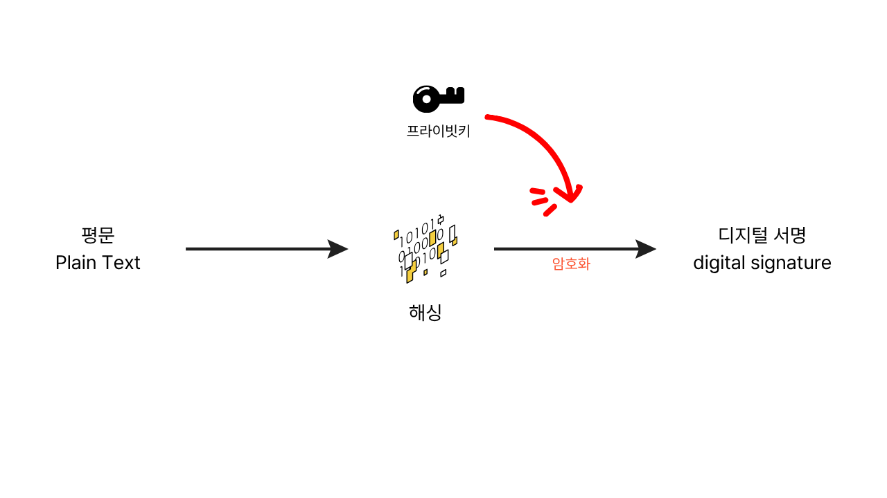
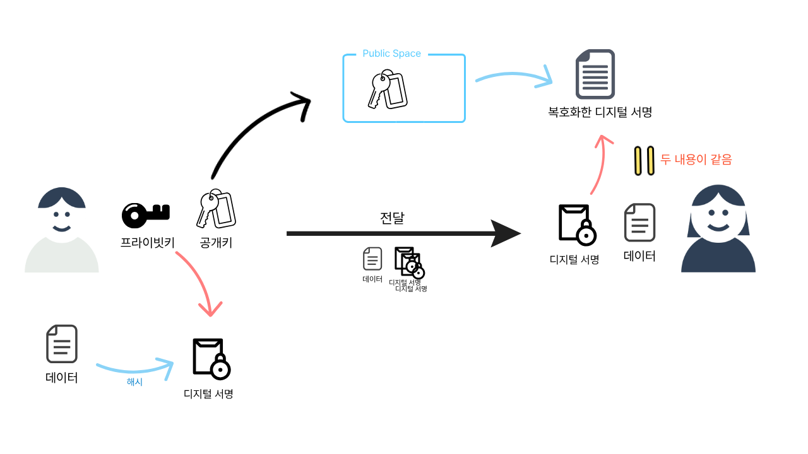

### 디지털 서명(전자 서명)

디지털 서명은 두 가지 문제를 해결해야 합니다.
**1. 무결성** - 문서가 중간에 변하지 않았는가?
**2. 인증** - 정말로 그 사람이 보낸 것이 맞는가?

여기서 **해시**와 **비대칭키** 는 각각 다음과 같은 역할을 맡습니다.
**해시:**   문서 전체의 고유한 “지문”을 만든다. (변조되면 지문이 완전히 달라짐)
**프라이빗키:** 그 지문을 암호화해서 “내가 보낸 것”임을 증명한다.
**공개키:** 누구나 서명을 검증할 수 있다.

즉, 절차는 이렇게 흘러갑니다.
1. 문서를 해시해서 해시값을 만든다.
2. 내 프라이빗키로 해시값을 암호화 한다. -> 이것이 디지털 서명
3. 문서 + 디지털 서명을 보낸다.
4. 받는 사람은 공개키로 서명을 풀어보고, 문서를 해시한 값과 비교한다.
- 같으면 문서가 변조되지 않았고 내가 보낸 게 맞음.
- 다르면 누군가 바꿨거나 내가 보낸 게 아님.

프라이빗키는 서명자만 가지고 있으므로, 제 3자는 새로운 유효한 서명을 생성할 수 없습니다.

이게 가능한 이유는 비대칭키(RSA 기준)의 특성 때문인데 프라이빗키로 암호화를 한 것은 공개키로 **복호화** 가 가능하고, 공개키로 암호화를 한 것은 프라이빗키로 **복호화** 가 가능하기 때문입니다.

