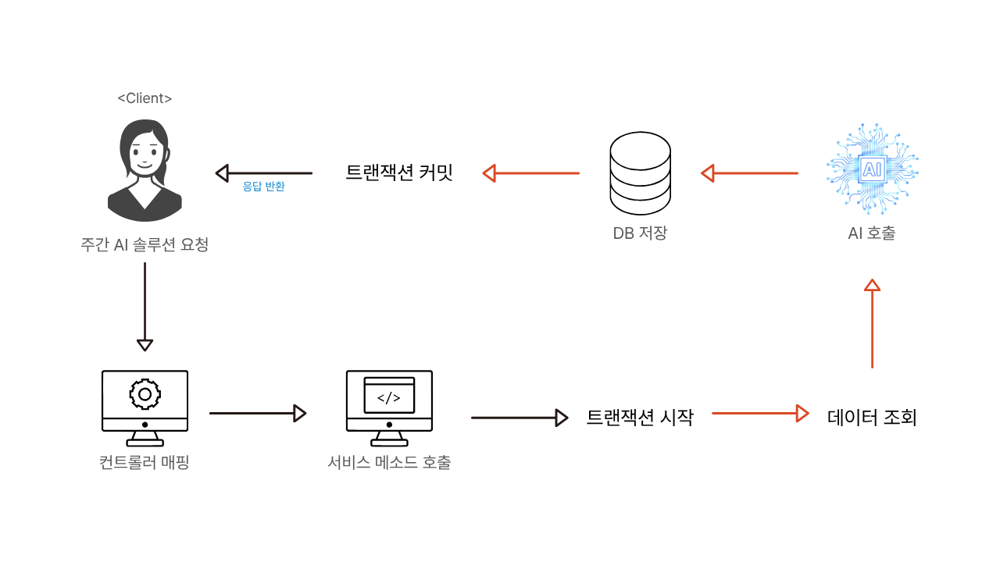
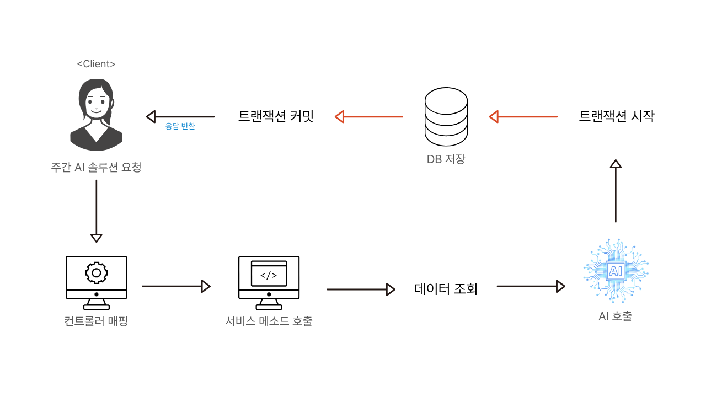
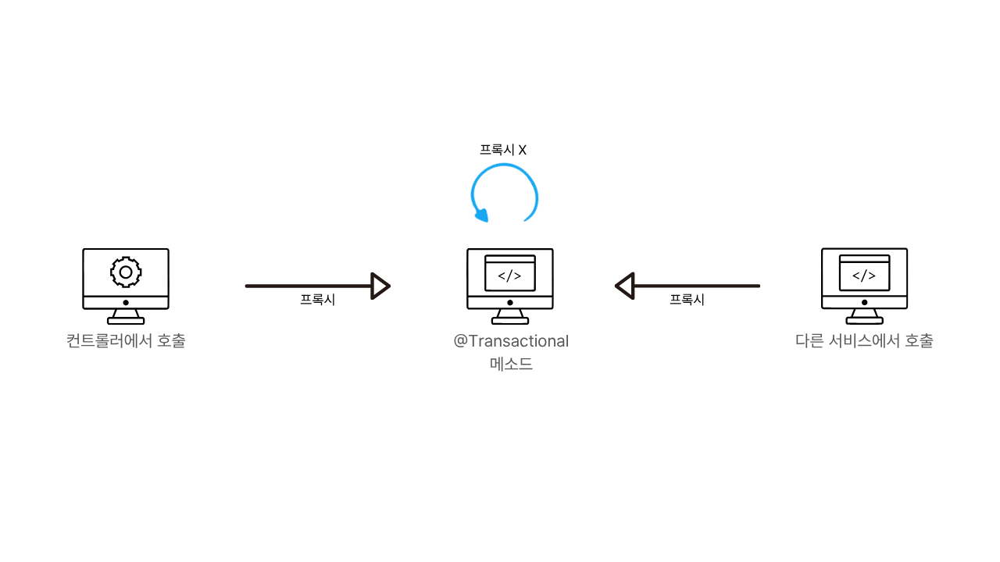
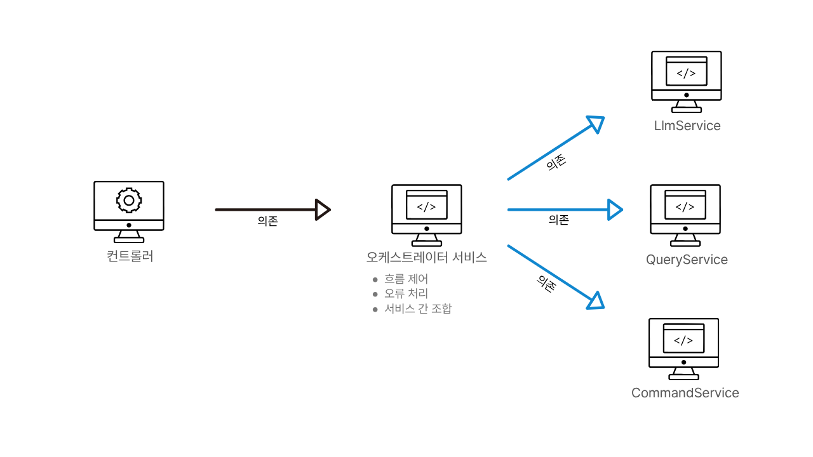

### 개요

혼자 테스트 할 때는 아무 문제가 없었지만, 해커톤 현장에서 4명이 동시에 요청을 보내면서 문제가 생김. 서버가 눈에 띄게 느려졌고, 심할 땐 500 에러까지 발생함.

원인은 서비스 설계 방식에 있었음. *“컨트롤러는 최대한 가볍게 유지해야 한다”* 는 생각 때문에, 하나의 서비스 메소드 안에서 데이터 조회 → AI 호출 → 저장 과정을 모두 몰아넣었었다. 특히 저장 부분에서 `@Transactional`이 필요하다고 판단해 해당 메소드 전체를 트랜잭션으로 묶어버린 것이 문제가 됨.

이번 글에서는 **AI 호출 부분과 DB 저장 부분을 분리하여 트랜잭션을 효율적으로 적용시키는 과정** 을 작성하였다.


---

### 문제 상황

AI를 호출하는 모든 Service 코드가 문제였지만 하나를 예시로 가져왔는데

```java
// 주간 AI 솔루션을 제공하는 메소드
@Transactional
public String getWeeklySolution(Long userId){
    
    // AI 호출을 위한 데이터 조회
    var weeklyData = paymentService.getWeeklyData(userId);
    
    // AI 호출 -> 최대 10초 지연 ⚠️
    String result = aiChatGateway.ai(systemPrompt, userPrompt);
    
    // 솔루션을 DB 에 저장 -> 트랜잭션 필요❗️
    solutionRepository.save(result);
    
    // 솔루션 반환
    return result;
}

```

현재 프로세스를 다이어그램으로 표현하면 아래와 같이 표현할 수 있다.





현재 서비스 코드의 **실행 순서**는 다음과 같이 진행됨

1. 데이터 조회
2. AI 호출
3. DB 저장
4. 데이터 반환
<br />

이 코드에서 문제점은 **실제로 트랜잭션이 필요 없는 부분까지 트랜잭션으로 감싸고 있다는 것** 이다.

- 데이터 조회는 읽기에 최적화 된 `@Transactional(readOnly = true)` 권장
- AI 응답 시간이 길어질 경우 DB 커넥션이 장시간 점유됨
- 동시에 여러 요청이 들어오면 커넥션 풀 고갈
- 현재 적용된 `@Transactional` 은 DB 저장 부분에서만 필요함

<br />

`@Transactional` 이 붙은 서비스가 호출 될 경우 자동으로 서비스 메소드 시작 전에 트랜잭션을 시작하고, 코드가 정상적으로 종료되면 자동으로 커밋을 해줌


<br />

---

### 해결방법


> - 트랜잭션을 필요한 부분만 감싸게 하여 **범위를 최소화** 한다.
> - CQRS 패턴을 도입한다.

결과를 저장하는 코드와 `@Transactional` 이 필요 없는 코드를 분리하기

```java
// ServiceImpl
// 주간 AI 솔루션을 제공하는 메소드
// @Transactional 없음
public String getWeeklySolution(Long userId){
    
    // AI 호출을 위한 데이터 조회
    var weeklyData = paymentService.getWeeklyData(userId);
    
    // AI 호출 -> 최대 10초 지연 ⚠️
    String result = aiChatGateway.ai(systemPrompt, userPrompt);
    
    // 결과를 저장하는 메소드 호출
    saveResult(result);
    
    // 솔루션 반환
    return result;
}

```

```java
// CommandServiceImpl
@Transactional  // 여기에 추가
public void saveResult(String result){
    solutionRepository.save(result);
}
```

이렇게 변경하면 트랜잭션의 범위가 필요한 곳만 커버함



- 외부 API 호출은 트랜잭션 밖에서 실행하여 **응답 지연이 DB 에 영향을 주지 않음**
- 트랜잭션의 범위가 최소화 되어 **커넥션 점유 시간이 최소화 됨**

<br />

---

### 해결에 CQRS 패턴을 도입한 이유

> CQRS 패턴은 읽기와 쓰기를 별도의 서비스 클래스로 분리해 확장성이 좋아지고 복잡한 도메인을 다루기 쉽게 해주는 패턴.

`@Transactional` 은 프록시 객체를 사용해서 동작하는데
여기서 프록시는 대신 서비스 메소드를 호출해주는 친구 정도로 먼저 이해하면 된다.




프록시는 다른 빈에서 호출이 될 때만 거치게 된다. 그러므로

- Controller -> Service 메소드 호출: 프록시가 **서비스 메소드 앞 뒤에 트랜잭션 시작/커밋 로직을 삽입하고 실행**
- Service 안에서 자기 자신의 메소드를 호출: 프록시를 거치지 않아 **트랜잭션 적용 X**


```java
@Service
public class PaymentService {

    public void methodA() {
        // 트랜잭션 없음
        methodB(); // 내부 호출 -> 프록시 안 거침
    }

    @Transactional
    public void methodB() {
        // 트랜잭션 적용 X 
    }
}
```

이 문제를 해결하기 위한 방법으로는 두 가지 방법이 있음.

1. CQRS 패턴 도입
결국은 `LlmService` 에서 `CommandService` 를 호출하는 것이니 프록시를 거치게 된다.
2. Controller 에서 여러 개의 서비스 메소드 호출

저는 컨트롤러는 얇게 끝내자는 의견이어서 CQRS 패턴 도입을 결정함.

<br />

---

### 오케스트레이터 서비스 도입

> **복잡한 시스템을 중앙 집중식으로 관리하는 소프트웨어 또는 시스템** 을 말한다. (Saga 패턴 참고)


#### ⚠️ CQRS 만 사용하는 경우

`LlmService`, `QueryService`, `CommandService` 누가 이 세 서비스를 호출하지? 지금은 `LlmService` 에서 조회/수정 서비스 메소드를 호출한다.

결과적으로 `@Transactional` 문제는 해결됐지만 `LlmService` 에 대한 역할 분리 문제가 새롭게 생김
<br />
#### ✅ 오케스트레이터가 필요한 이유




1. 역할 분리
`LlmService` 는 외부 API 어댑터 역할.
`QueryService`/`CommandService` 는 도메인 데이터 조회/변경을 책임짐.
`오케스트레이터` 는 흐름(순서)을 결정함. 오케스트레이터의 메소드만 보면 흐름을 확인하기 좋다.

2. 확장성 
흐름을 관리하는 서비스에서 확장하기 좋음.

3. 트랜잭션 경계를 명확히 할 수 있음
`CommandService` 에서만 트랜잭션을 적용하였으므로 save 는 트랜잭션 안, 그 외에는 트랜잭션 밖이라는 것을 보장함.


```java
// 오케스트레이터
@Service
@RequiredArgsConstructor
public class SolutionService {  

    private final QueryService query;  // 읽기 전용 서비스
    private final LlmService llm;  // Ai 호출 전용 서비스
    private final CommandService cmd;  // 변경 전용, @Transactional 적용

    public String getWeeklySolution(Long userId) {
        var user = query.getEntity(userId);  // 유저 검증
        
        var answer = llm.ask(prompt);  // 트랜잭션 밖에서 ai 호출
        
        cmd.saveSolution(user.getId(), answer); // 트랜잭션 시작 지점
        
        return answer;  // 결과 반환
    }
}
```

컨트롤러에서는 오케스트레이터만 주입 받으면 되어서 코드가 간결해짐

<br />

---

### 오늘의 경험

- **외부 API 는 트랜잭션 안에 포함시키면 안된다.**
응답 지연이 있으면 DB 커넥션을 점유하게 된다. 결국 다른 요청까지 영향을 받을 수 있다.

- **트랜잭션은 최소한의 단위로 적용하자.**
지나치게 큰 트랜잭션 범위 설정은 문제를 일으킬 가능성이 높다.

- **CQRS 를 적극 활용하자**
@Transactional 프록시 문제나, 다방면에서 좋은 패턴이다.

- **오케스트레이터를 적극 도입하자**
개인적으로 중앙 집중식 관리를 좋아하는데, 서비스 개발에 큰 도움이 될 것 같다.
