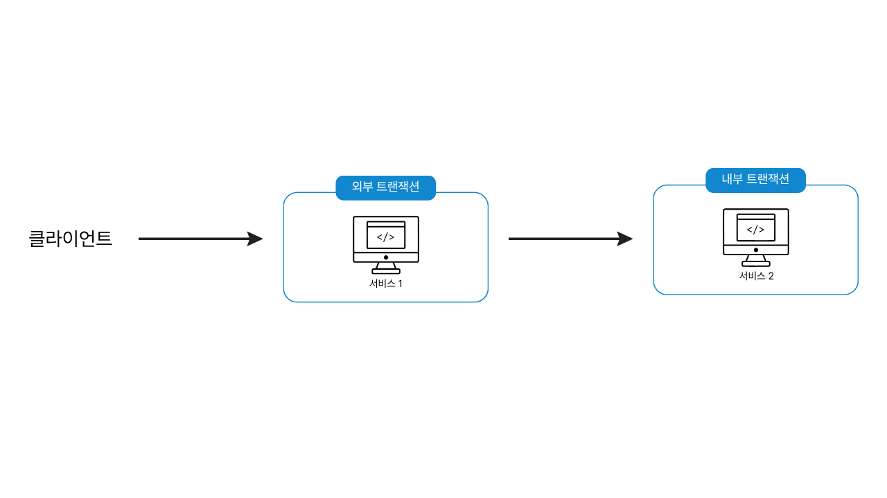
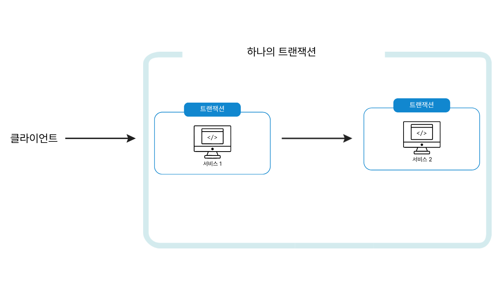
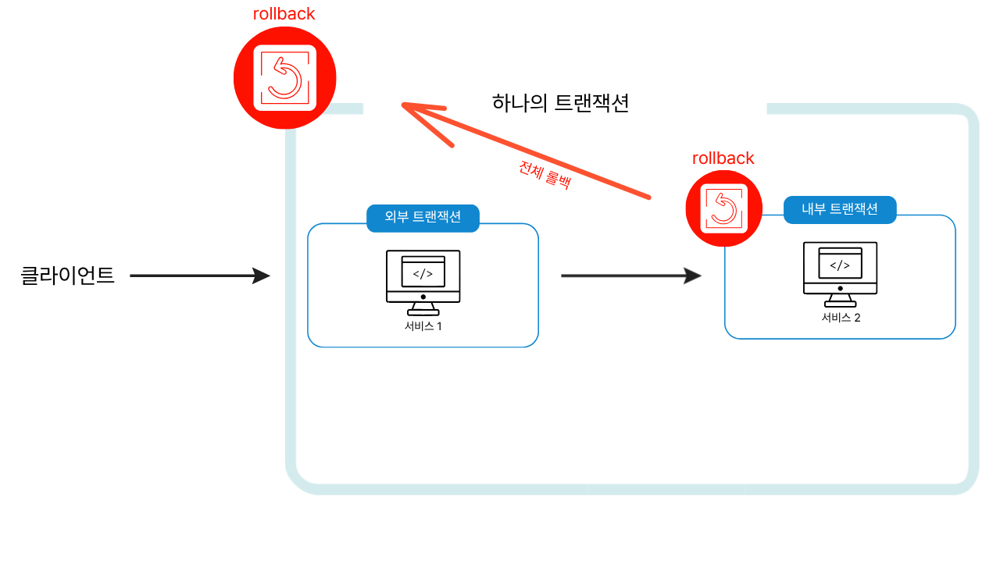

### 외부 트랜잭션과 내부 트랜잭션

트랜잭션이 이미 진행중인데 여기서 또 트랜잭션이 시작되면 어떻게 될까?

`@Transactional` 에 아무 옵션이 없다면 기본적으로 외부 트랜잭션에 합류하게 됨.
마치 하나의 트랜잭션 처럼 동작하게 되는 것이다.

 

**원칙** 
- **모든 외부/내부 트랜잭션이 커밋되어야 최종적으로 커밋된다.**
- **하나의 외부/내부 트랜잭션이 롤백되면 최종적으로 롤백된다.**

 

#### 하나의 트랜잭션이 롤백된다면?

외부 트랜잭션에 합류하였으므로 두 트랜잭션은 하나와 같음.
즉 최종적으로 외부 트랜잭션 까지 롤백이 강제된다.

 

#### 내부가 롤백 되었는지 어떻게 알지?

트랜잭션이 시작 될 때는 이 트랜잭션이 *처음 생성되었는가?* 를 체크함.
만약 처음이 아니라면(내부) 물리적으로 아무 동작도 하지 않음.

내부에서 롤백이 발생하면 `rollbackOnly` 를 `true` 로 설정한다.
이 설정이 되어있어서 외부에서는 작업이 끝나고 롤백을 진행하게 된다.

 

---

### 다양한 전파 옵션

사용할 수 있는 다양한 옵션을 설명하려고 한다.

- REQUIRED (기본값)
이미 트랜잭션이 있으면 그대로 참여하고, 없으면 새로 시작함.

- REQUIRES_NEW
항상 새로운 트랜잭션 시작. 기존 트랜잭션은 잠시 보류함.

- SUPPORTS
트랜잭션이 있으면 참여, 없으면 그냥 트랜잭션 없이 실행.

- MANDATORY
반드시 트랜잭션이 있어야 함. 없으면 예외 발생.

- NEVER
트랜잭션 있으면 예외 발생. 반드시 트랜잭션 없이 실행.

- NOT_SUPPORTED
트랜잭션이 있으면 중단시키고 트랜잭션 없이 실행.