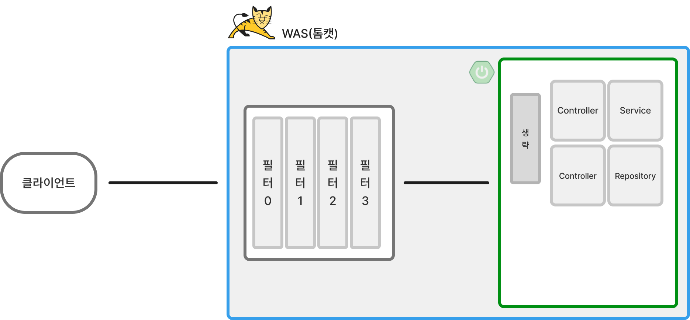
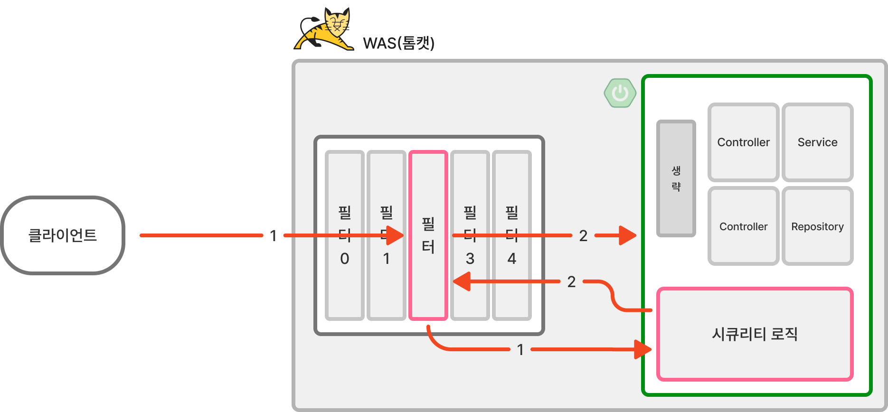
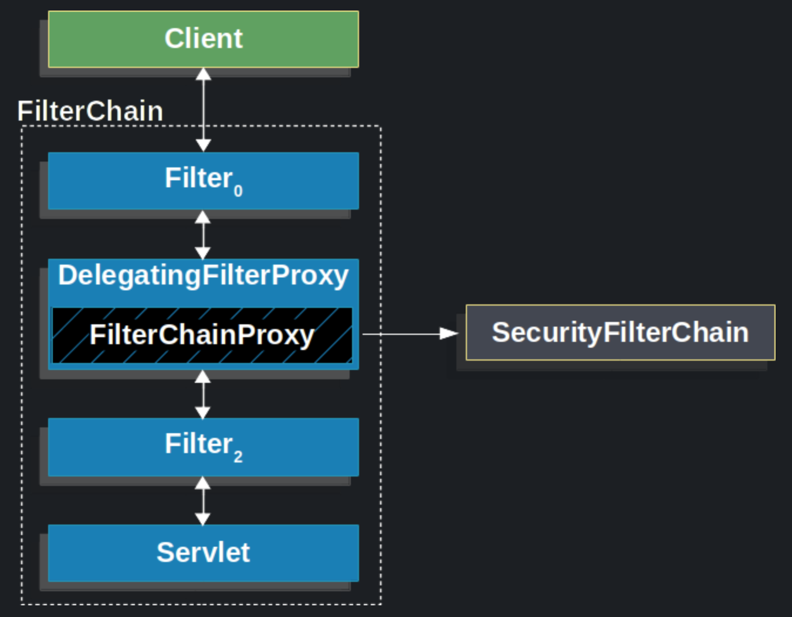
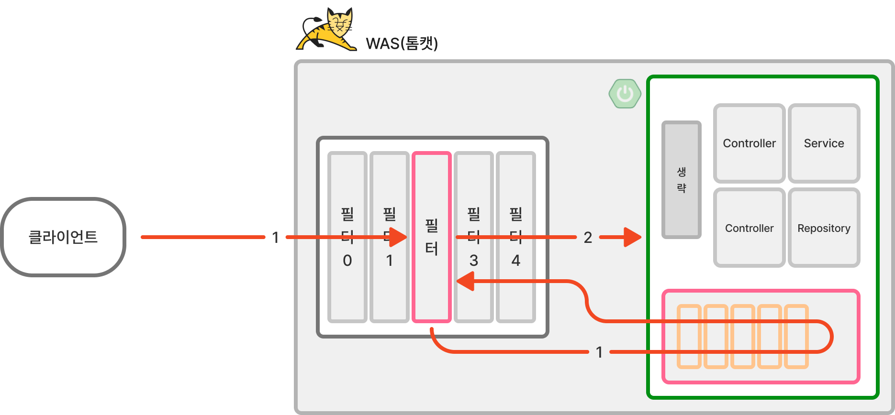
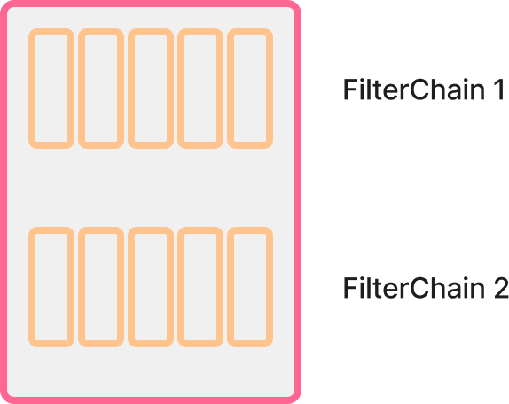
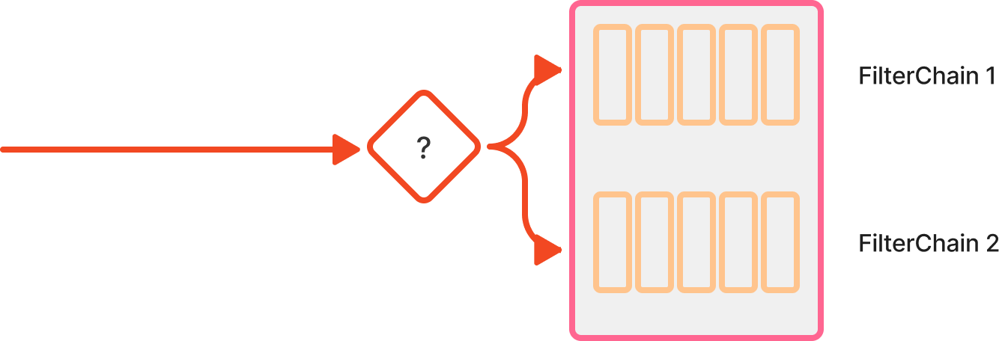

<span style="color: lightgray">(개발자 유미 님의 영상을 바탕으로 작성하였음.)</span>

### Spring Security 가 없을 때




시큐리티 의존성을 추가하지 않았을 때의 스프링 MVC 요청 처리 흐름이다.
클라이언트의 요청은 WAS 의 여러 필터들을 통과하여 스프링 컨테이너에 도달한다.

<br />

---

### Spring Security 추가

스프링 시큐리티는 WAS 의 필터단에서 클라이언트의 요청을 가로채고 역할을 수행한다. 

1. 필터단에서 요청을 가로챈다.
2. 스프링 컨테이너 내부에 구현되어 있는 스프링 시큐리티 로직을 수행한다.
3. 시큐리티 로직을 끝내고 다시 WAS 필터단으로 돌아온다.



요청이 들어오면 여러 필터 중 하나가 이를 가로채서 시큐리티 로직을 수행하고, 다시 필터 체인으로 반환하여 정상적인 흐름으로 이어지는 것을 볼 수 있다.

<br />

 <span>-</span> 공식 이미지 -



<br />

---
### 시큐리티 로직의 구성
  
Spring Security 에서는 여러 필터가 모여 하나의 필터 체인을 이룬다. 이 체인이 인증, 인가 등 시큐리티 로직을 담당한다.



주황색 사각형 각각의 필터에서 CSRF, 로그아웃, 로그인, 인가 등의 작업을 수행한다. 

하지만 시큐리티 로직은 여러 개의 필터 체인을 가질 수 있다. 



어떤 경우에 어떤 FilterChain 을 사용할 것인지를 명시해주어야 한다.

먼저 두 개의 필터 체인을 등록한다.


``` java
@Configuration
@EnableWebSecurity
public class SecurityConfig {

    @Bean
    @Order(1)
    public SecurityFilterChain filterChain1(HttpSecurity http) throws Exception{

        return http.build();
    }

    @Bean
    @Order(2)
    public SecurityFilterChain filterChain2(HttpSecurity http) throws Exception {

        return http.build();
    }

}
```

**FilterChainProxy** 는 등록된 여러 SecurityFilterChain 중에서 하나를 선택하여 작업을 수행하게 한다.



<br />


---

### 멀티 SecurityFilterChain 경로 설정


`securityMatchers` 를 통해 SecurityFilterChain 에 대한 경로를 매핑해준다. 
아래 코드에서 filterChain1 은 `/user` 경로에 대해 적용하고, filterChain2 는 `/admin` 경로에 대해 적용한다. 

``` java
@Bean
@Order(1)
public SecurityFilterChain filterChain1(HttpSecurity http) throws Exception {

    http
            .securityMatchers((auth) -> auth.requestMatchers("/user"));

    http
            .authorizeHttpRequests((auth) -> auth
                    .requestMatchers("/user").permitAll());

    return http.build();
}

@Bean
@Order(2)
public SecurityFilterChain filterChain2(HttpSecurity http) throws Exception {

    http
            .securityMatchers((auth) -> auth.requestMatchers("/admin"));

    http
            .authorizeHttpRequests((auth) -> auth
                    .requestMatchers("/admin").authenticated());

    return http.build();
}
```

