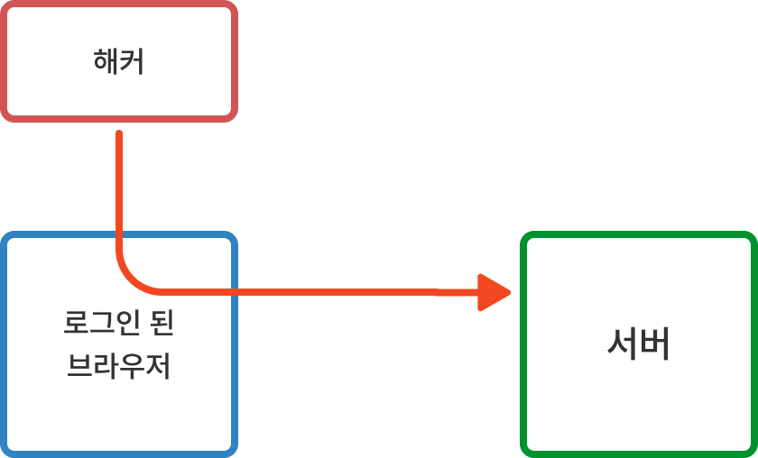
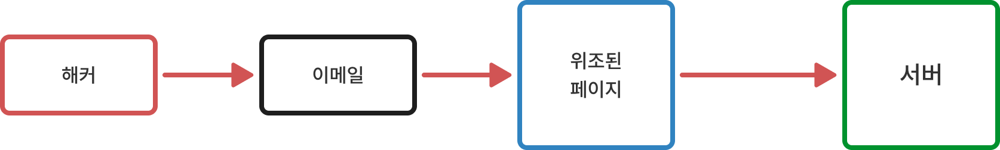

### Cross-Site Request Forgery

로그인 된 사용자는 원하지 않지만, 해커가 원하는 요청을 유도하는 공격 기법이다.
만약 공격 받은 브라우저에 관리자로 로그인 되어있다면 피해가 커지게 된다.

 

---
### GET 요청의 행위

모든 GET 요청은 안전해야 한다. 서버의 리소스 상태를 바꾸면 안된다.

예를 들어 https://www.testkwangwoon.ac.kr/posts/delete/1 이라는 URL 이 존재한다고 생각해보자. 

이 경로는 권한이 있는 유저(관리자, 작성자) 만 지울 수 있게 설계하였다고 가정하자.(권한이 없는 사람이 요청하면 아무일도 안 일어남)

하지만 GET 요청 URI 에 행위 `delete` 를 넣었고, GET 요청을 보냈을 때 실제로 데이터가 지워진다면 해커는 유저에게 저 경로를 실행하게 유도할 수 있다.

1. 주소 요청을 보내는 HTML 태그를 만든다.
-> <a\> 태그 href="위 주소"
->  태그 src="위 주소"
2. 해당 태그를 유저에게 보냄
-> 이메일
-> 공개된 게시판

 태그는 웹 페이지 로드 시에 자동으로 해당 URL 에 GET 요청을 보낸다.

#### 해결방법
해결방법은 간단하다. HTTP 메소드가 의미하는 행위를 하지 않는다.
GET 은 "안전"해야 한다. 

허용되는 것: 서버 로그 기록 등
금지되는 것: 읽음 표시 변경, 좋아요/삭제/취소/생성 등 데이터가 달라지는 행위.

 

---

### 인증 방식에 따른 위험성

CSRF 공격은 세션 방식에서 큰 위험성을 가진다. 

#### 쿠기-세션 인증
세션 방식 인증은 접근하는 브라우저 별로 하나의 쿠키를 발급하고, 그 쿠키에 대응하는 정보를 서버에 저장한다. 
쿠키는 매 요청 마다 필수적으로 전송된다. 

#### JWT 방식
JWT 방식의 경우 로그인을 마친 사용자에게 JWT 토큰을 발급하고, 인증이 필요할 때 JWT 를 보내지만, JWT 의 특성상 로컬스토리지에 저장되기 때문에 자동으로 요청에 포함되지 않는다. 

#### 위험성
자동으로 포함되어 함께 전송되는 지에 따라서 CSRF 의 위험성이 달라진다. 
자동으로 포함된다는 것은 해커가 만든 트랩에도 인증할 수 있는 요소가 포함된다는 것을 의미하기 때문이다.

하지만 JWT 도 완전히 안전한 것은 아니다. 만약 로컬스토리지가 아닌 쿠키에 저장할 경우 CSRF 공격을 조심해야 한다.
