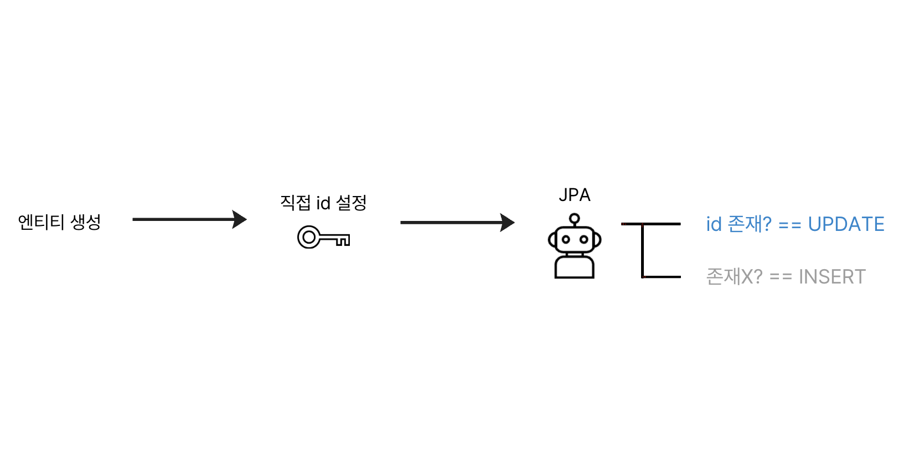

### 들어가며
이번 프로젝트를 진행하며 테스트 단계에서는 빠른 개발을 위해 Auto_Increment 전략을 사용하였다. 하지만 이 방식은 단순히 쿼리 파라미터를 변경하는 것만으로도 다른 레코드에 접근할 수 있다는 문제가 있다. 예시: `?eventId=1` 

이러한 문제점은 실제 서비스 환경에서 무분별한 데이터 노출의 원인이 될 수 있다. 예측 가능성이 보안 취약점으로 이어질 수 있어, Auto Increment 전략을 그대로 사용하는 것은 적절하지 않다고 판단하였다.

이러한 이유로 예측 불가능한 PK 전략을 도입한다.


_**대체 방안**_

1. UUID
128 비트 랜덤 기반 식별자이다. 충돌 가능성이 사실상 없다.
2. 랜덤 64비트 숫자
충돌 가능성이 0은 아니지만 Long 타입을 유지하고 싶은 경우 고려해볼 수 있다.
3. Snowflake ID
64비트 정수형 ID 이다. 타임스탬프 + 데이터센터 ID + 머신 ID + 시퀀스 조합으로 구성한다. 유일성을 보장한다.
4. TSID
Snowflake 를 단순화한 형태로, 시간순 정렬이 가능한 64비트 숫자형이다.
구현이 간단하다.

이 외에도 많은 전략들이 있지만 소개하는 자리는 아니므로 넘어간다.

<br />

### 문제 상황
**_UUID_**
이미 기능 구현을 완료하였고, PK 의 타입을 바꾸기에는 부담이었다. 이미 타입은 `Long` 이고, 'UUID' 의 경우 `UUID` 타입이므로 좋은 대체 방안이었지만 후보에서 제외 되었다. 
**_랜덤 64비트 숫자_**
간단하게 난수로 생성하여 PK 로 설정한다. `Long` 타입이고 별도의 의존성이 없이도 쉽게 구현이 가능하다. 하지만 JPA 문제점으로 가독성 떨어지는 설정 코드가 추가로 필요하다.
**_Snowflake_**
운영 난이도가 있다고 생각하여 보류하였다.

랜덤 64비트 숫자가 가장 현실적이라고 생각하였지만, 적용하려니 문제가 생겼다. 

### JPA 의 save()
랜덤 64비트 숫자를 PK 로 설정하는 방식을 적용하는 과정에서 예상치 못한 문제가 발생했다. 
JPA 는 엔티티를 save() 할 때, id 값이 존재하면 해당 엔티티를 '신규 생성(new)' 이 아니라 '수정(update)' 로 간주한다.

문제는 다음과 같다.
1. 📋 엔티티 생성 시 직접 id 필드에 설정
2. 🤖 JPA 는 "id가 존재하니 이미 존재하는 엔티티일 수 있다"고 판단.
3. 🔎 save() 호출 시 "INSERT" 가 아닌 "UPDATE" 쿼리 실행 시도.
4. ❌ 실패
5. ❗️ 예외 발생

(`@GeneratedValue` 가 붙은 id 에 값을 직접 넣으면 Hibernate 가 이미 저장된 엔티티로 보고 merge 하다가 예외가 날 수 있다. `@GeneratedValue` 가 없다면 예외 대신 save() 마다 SELECT 가 한 번 더 실행된다.)

하지만 id 없이 저장하고 나중에 값을 설정하는 방식은 JPA 구조상 불가능하여 모순이 발생한다.



물론 해결 방안은 있지만, 좀 더 편하고 복잡한 구현이 없는 방법을 원했다.

### TSID란?
TSID 는 사실상 충돌이 없고<span style="color:gray">(거의 유일)</span> 생성된 시간 순서대로 정렬이 잘 된다.
상위 비트: 타임스탬프
중간 비트: 노드 ID
하위 비트: 랜덤값으로 시작하는 카운터

그래서 숫자 하나만 봐도 대략 언제 생성된 ID 인지 추론이 가능하고, `ORDER BY id DESC` 같은 단순 정렬로 최근 데이터 먼저 가져오는 것이 가능하다. 

#### 왜 TSID? 
`Long` 타입이 가능하고, 예측하기 어려운 PK, 구현이 단순하다. 

#### TSID 적용 방법
의존성 추가

``` gradle
implementation 'io.hypersistence:hypersistence-utils-hibernate-63:3.7.6'
```

엔티티에 어노테이션 추가

``` java
@Id
@Tsid
private Long id;
```

### 마치며
이번 프로젝트에서 개발 편의성을 위해 Auto Increment 를 사용했지만, 예측 가능한 식별자가 보안 취약점으로 이어질 수 있음을 확인하였다. 이를 해결하기 위해 랜덤 64비트 식별자를 적용하는 과정에서 JPA 가 "id 존재 여부"로 신규 생성과 수정을 판별한다는 구조적 제약도 직접 마주하게 되었다.

결국 구현 난이도, 코드 가독성 등을 고려해 TSID 방식이 매우 적합하다는 결론에 도달했다. 

앞으로의 식별자 선택은 프로젝트 초기 설계 단계에서 신중하게 선택해야 한다는 생각을 갖게 되었다. 