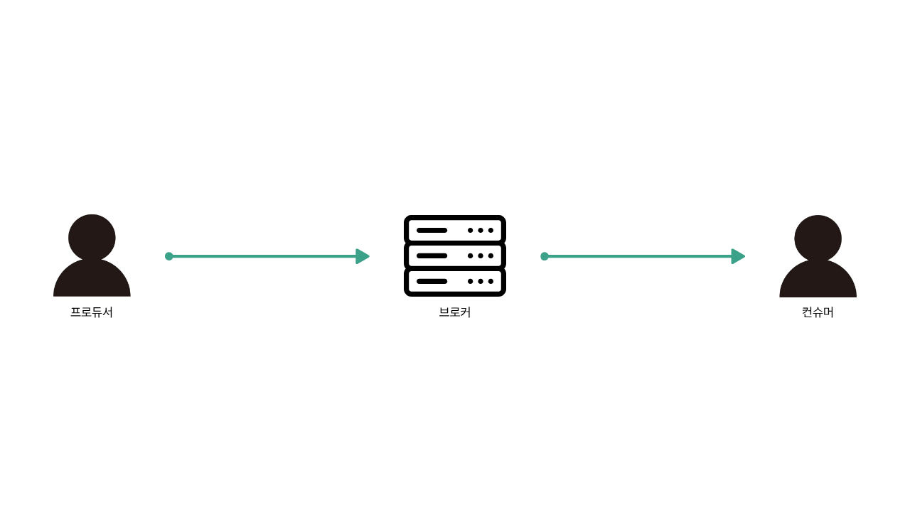
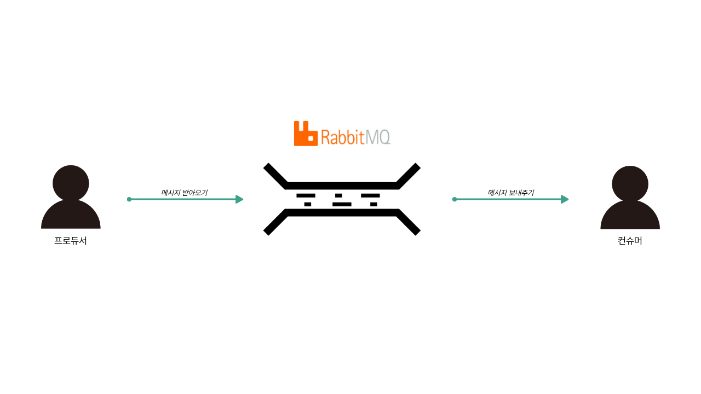

### RabbitMQ 가 뭐지?

애플리케이션 간 메시지를 안전하게 전달하기 위한 `메시지 브로커` 입니다.

처리해야 하는 작업들을 큐에 넣어놓고 Consumer(소비자)가 순차척 혹은 병렬적으로 가져가서 처리하도록 하는 시스템입니다.

RabbitMQ 는 비동기 처리, 작업 분산 등을 목적으로 사용됩니다.

---

### 메시지 브로커가 필요한 이유

폴링 시스템을 예로 들면, 다음과 같은 문제가 발생할 수 있습니다.
- 이벤트 수 증가 -> 처리 시간 증가
- 외부 API 지연 -> 전체 흐름 지연
- 하나의 실패가 전체 폴링 실패로 이어짐

[Poller] : 처리 대상 이벤트 조회 -> 메시지 큐에 전달(비동기)
[Worker] : 큐에서 메시지 수신 -> 외부 API 호출 및 데이터 저장

Poller 는 빠르게 끝나고, 무거운 작업은 Worker 에서 분산 처리합니다.

 

### RabbitMQ 의 구성 요소

#### 1. Producer
메시지를 RabbitMQ 에 보내주는 주체입니다.

예를 들어 주기적으로 폴링을 해야한다고 할 때, 스케쥴러를 사용하여 데이터를 조회하고 Producer 를 통해 메시지 큐에 전달합니다.

#### 2. Queue
메시지가 쌓이는 공간입니다.
Queue 는 "해야 할 일 목록" 으로 생각하면 됩니다.

#### 3. Consumer(소비자)
Queue 에서 메시지를 받아서 실제 작업을 수행하는 주체입니다.
여러 개를 두면 병렬 처리가 가능합니다.

 

---

### RabbitMQ 의 동작 방식

1. Producer 로부터 메시지를 받아와 큐에 저장하기
2. 큐에 있는 메시지를 Consumer 에게 보내주기
3. 해당 메시지를 제거하기

이 세 가지 동작을 수핵합니다.

반면 Consumer 는 다른 것을 고려할 필요 없이 데이터를 처리하면 됩니다.
> 여러 Consumer 를 놓으면 병렬 처리가 가능하다.

 

### RabbitMQ 사용 흐름

폴링 시스템에서 적용을 시켜보겠습니다.

#### 1. Poller(Producer 역할)

polling 대상 이벤트 조회 후 이벤트 정보를 메시지로 변환하고
Queue 에 전달하기.

#### 2. Worker(Consumer 역할)

Queue 에서 이벤트 수신하고 해당 메시지를 바탕으로 외부 API 호출 및 결과 저장

 

### 예외 처리

RabbitMQ 는 실패 전략이 명확합니다.
Consumer 에서 작업 도중 예외가 발생하면 해당 메시지를 다시 Queue 로 집어넣으면 됩니다.

 

---

### Ref
최동근 - SpringBoot 을 이용한 RabbitMQ 구축하기 (2023년 8월 16일)
