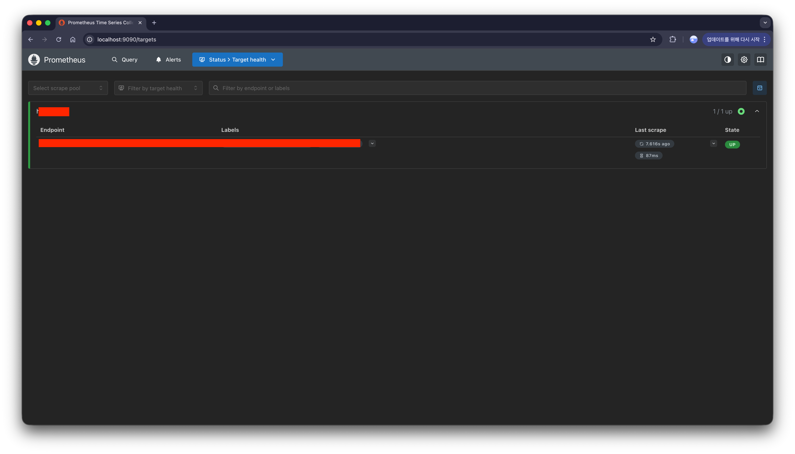
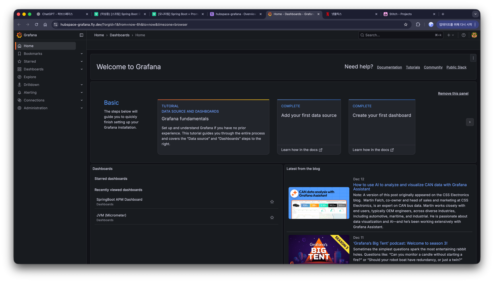

## 들어가며

프로젝트를 진행하며 서비스에 들어가기 전에 부하 테스트와 분석하기 편한 모니터링 도구의 도입이 필요해졌다. 


## <span style="color:grey"> Prometheus </span>

### Prometheus 란?

Prometheus 는 시스템과 애플리케이션의 상태를 수치로 수집, 조회, 저장하여 문제를 조기에 감지하기 위한 오픈소스 모니터링 도구이다. 

Prometheus 는 Grafana 와 같은 시각화 도구와도 쉽게 통합되어 직관적인 대시보드로 모니터링을 할 수 있게 한다.


## <span style="color:grey"> Grafana </span>

### Grafana 란?

데이터 소스로부터 수집된 시계열 데이터를 시각화하여 대시보드 형태로 제공하는 오픈소스 데이터 시각화 도구이다.

> 시계열 데이터란 특정 시간에 기록된 메트릭 값을 기반으로 시간에 따라 변화하는 데이터를 추적하고 저장하는 방식이다.

### Grafana 를 선택한 이유

Grafana 는 시계열 메트릭을 직관적으로 표현하는 데 장점을 가진 시각화 도구이다. 그래프, 게이지, 히트맵 등으로 시스템의 상태를 한눈에 파악할 수 있다.
Grafana 는 Prometheus 를 대표 데이터 소스로 네이티브 지원을 한다. 


## 적용하기

> 들어가기에 앞서, API 서버와 Prometheus, Grafana 는 각각 분리하여 배포한다.
EC2 의 경우 분리할 필요는 없지만 운영적으로는 분리하는 것이 좋다고 한다. 하지만 이 글에서는 Fly.io 호스팅 서비스를 사용하여 분리가 강제된다.

### 의존성 추가

``` build.gradle
dependencies {
  implementation 'org.springframework.boot:spring-boot-starter-actuator'
  implementation 'io.micrometer:micrometer-registry-prometheus'
}

```

### application.yml

``` yml
management:
  server:
    port: 9000
    address: 0.0.0.0
  endpoints:
    web:
      exposure:
        include: prometheus, health
  endpoint:
    health:
      show-details: never
```

- server.port: 모니터링 기능을 9000번 포트에서 실행
- server.address: 외부 서버에 있는 Prometheus 가 데이터를 가져갈 수 있게 허용
- endpoints.w.e.include: prometheus 가 해석할 수 있는 포맷으로 메트릭 데이터를 제공
- endpoint.h.show-details: 상태 정보를 단순하게 표시

<span style="color:indianred">9000번 포트는 외부에서 접근하게 되면 치명적인 보안 문제가 된다. Prometheus 의 서버 IP 에서만 접근 가능하도록 막아야 한다.</span>


### prometheus.yml 작성

> 경로: prometheus/prometheus.yml

스프링과 분리하여 prometheus 디렉토리를 따로 만들고 prometheus.yml 을 만든다.

#### Fly.io 사용

Fly.io 를 사용할 때는 `appName.internal` 로 내부망 접근이 가능하다.

``` yml 
global:
  scrape_interval: 15s

scrape_configs:
  - job_name: "appName-api"
    metrics_path: "/actuator/prometheus"
    static_configs:
      - targets:
          - "appName-api.internal:9000"
```


#### EC2 사용(같은 EC2 사용)

docker-compose.yml 을 만들면 이런 모양이 될 것이다. 
여기서 `hostName` 이 바로 API 서버이다.

``` yml
services:
  hostName:  # 이 서비스 이름이 호스트명이 됨
    ...
  prometheus:
    ...
```

prometheus.yml

``` yml
scrape_configs:
  - job_name: "서비스 명"
    metrics_path: "/actuator/prometheus"
    static_configs:
      - targets:
          - "서비스명:9000"  # 서비스명:포트
```


#### EC2 사용(다른 EC2 사용)

prometheus.yml

``` yml
scrape_configs:
  - job_name: "서비스 명"
    metrics_path: "/actuator/prometheus"
    static_configs:
      - targets:
          - "172.31.10.5:9000"  # API 서버의 Private IP
```


### Prometheus Dockerfile 작성

``` dockerfile
FROM prom/prometheus:latest
COPY prometheus.yml /etc/prometheus/prometheus.yml
```

### <span style="color:grey">볼륨 설정(Fly.io 만 해당)</span>

1. 다음 명령어로 앱을 생성한다. 

``` cli
fly launch --name 앱_이름 --no-deploy
```

{: start="2"}
2. 다음 명령어로 볼륨을 설정한다.

```cli
fly volumes create prometheus_data --size 3 --region nrt --app 앱_이름
```

볼륨은 쉽게 말해서 외장하드 라고 볼 수 있다.

{: start="3"}
3. prometheus/fly.toml 에 mount 추가

``` toml
[mounts]
  source = "prometheus_data"
  destination = "/prometheus"
```

http_service 를 제거하여 외부에 노출시키지 않는다.

{: start="4"}
4. 배포

``` cli
fly deploy --app 앱_이름
```


### Grafana 적용하기
> 경로: grafana/provisioning/datasources/datasource.yml

Spring 과 Prometheus 와 분리하여 grafana 디렉토리를 생성한다.
그리고 `datasource.yml` 에 다음 내용을 작성한다.

``` yml
apiVersion: 1

datasources:
  - name: Prometheus
    type: prometheus
    access: proxy
    url: http://prometheus.internal:9090  # 프로메테우스 주소
    isDefault: true
```

### Grafana Dockerfile 작성

> 경로: grafana/Dockerfile

``` dockerfile
FROM grafana/grafana-oss:latest
COPY provisioning /etc/grafana/provisioning
```

### <span style="color:grey">배포 및 설정(Fly.io 만 해당)</span>

1. 앱 생성

``` cli
fly launch --name 앱_이름 --no-deploy
```

{: start="2"}
2. Grafana 볼륨 설정

``` cli
fly volumes create grafana_data --size 3 --region nrt --app 앱_이름
```

{: start="3"}
3. grafana/fly.toml 에 추가

``` toml
[mounts]
  source = "grafana_data"
  destination = "/var/lib/grafana"
```

{: start="4"}
4. 관리자 계정/비밀번호 설정

``` cli
fly secrets set \
  GF_SECURITY_ADMIN_USER=admin \
  GF_SECURITY_ADMIN_PASSWORD='비밀번호' \
  --app Grafana_앱_이름
```

{: start="5"}
5. 배포

``` cli
fly deploy --app hubspace-grafana
```

<br />

## 테스트

### Prometheus

Prometheus 는 Flyio 의 경우 `fly proxy 9090:9090 --app prometheus_앱_이름` 를 터미널에 입력해야 로컬에서 접속할 수 있다.
EC2 의 경우 Prometheus 의 IP 로 접속하면 된다.



Status > Targets 에 들어가면 API 서버가 보이고 State 가 `UP` 이면 성공이다.


### Grafana

Grafana 는 Flyio 의 경우 `Hostname` 으로 그냥 들어갈 수 있다.
EC2 의 경우 Prometheus 와 방식으로 접속하면 된다.

로그인을 하고 아래와 같은 화면이 보인다면 성공이다.
대시보드 구성은 이번 포스트에서는 스킵하려고 한다. `Grafana 템플릿` 을 검색하면 모니터링 대시보드 템플릿을 찾아볼 수 있다.


