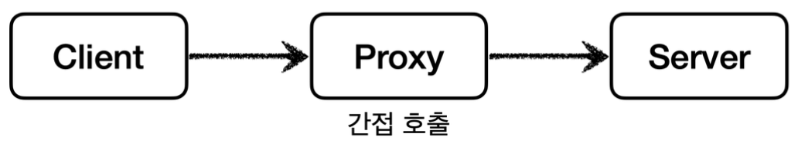
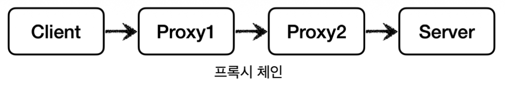

## 들어가며

로그 추적기를 만들면서 각 레이어의 각 메서드 마다 코드 측정하는 중복 코드가 생기는 것이 문제였고, 해당 문제를 해결하기 위해 동적 프록시 기술을 적용하려고 한다. 동적 프록시 기술의 기반인 프록시 패턴과 데코레이터 패턴을 먼저 정리하고 넘어가려고 한다.

## 프록시 패턴(Proxy Pattern)

### 프록시 패턴이 뭔가요?

프록시 패턴은 실제 프록시를 사용하는 것은 아니다. 하지만 프록시처럼 동작을 한다.
실제 객체에 직접 접근하지 않고, 프록시 객체를 두어서 접근을 제어하는 디자인 패턴이다.

클라이언트는 프록시를 통해서 요청하고, 프록시는 실제 객체에게 작업을 요청한다.
프록시 객체는 여러 개가 존재하여 체인을 형성할 수 있다.

### 왜 프록시가 필요할까?

접근 권한을 제어해야 하는 경우, 예를 들어 캐시가 존재한다면 캐시를 반환하고 존재하지 않는다면 실제 객체에 요청을 보내어 값을 가져올 수도 있다.

이러한 요구를 기존 코드 수정 없이 해결하기 위해서 프록시 패턴이 사용된다.

## 데코레이터 패턴(Decorator Pattern)

### 데코레이터 패턴이 뭔가요?

사실 데코레이터 패턴 역시 프록시 패턴이라고 할 수 있다. 데코레이터 패턴의 경우 응답 값을 꾸며주는 역할을 한다. 예를 들면 로그 기능, 성능 측정 등을 말한다.

---

### 프록시 패턴 vs 데코레이터 패턴

데코레이터 패턴 역시 프록시 패턴이라고 한다면 왜 둘을 나누었을까? 여기서 중요한 것은 *의도* 이다. 디자인 패턴에서 중요한 것은 모양이 아니라 *의도*이다. 

- 프록시 패턴의 의도: 다른 객체에 대한 **접근을 제어**하기 위함
- 데코레이터 패턴의 의도: **객체에 추가 기능을 동적으로 추가**하고 기능 확장을 위함

| 구분       | 데코레이터 패턴  | 프록시 패턴     |
| -------- | --------- | ---------- |
| 목적       | 기능(책임) 추가 | 접근 제어      |
| 핵심 관심사   | 확장        | 제어         |
| 클라이언트 인식 | 장식된 객체    | 대리 객체      |
| 사용 이유    | 기능 조합     | 보호, 지연, 제어 |

데코레이터 패턴은 기존 객체를 수정하지 않고, 객체를 감싸는 방식으로 기능을 유연하게 확장하는 디자인 패턴이다.

---

## 참고

김영한의 스프링 핵심 원리 - 고급편. &lt;프록시 패턴과 데코레이터 패턴> 챕터