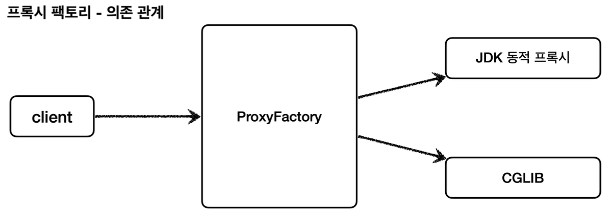
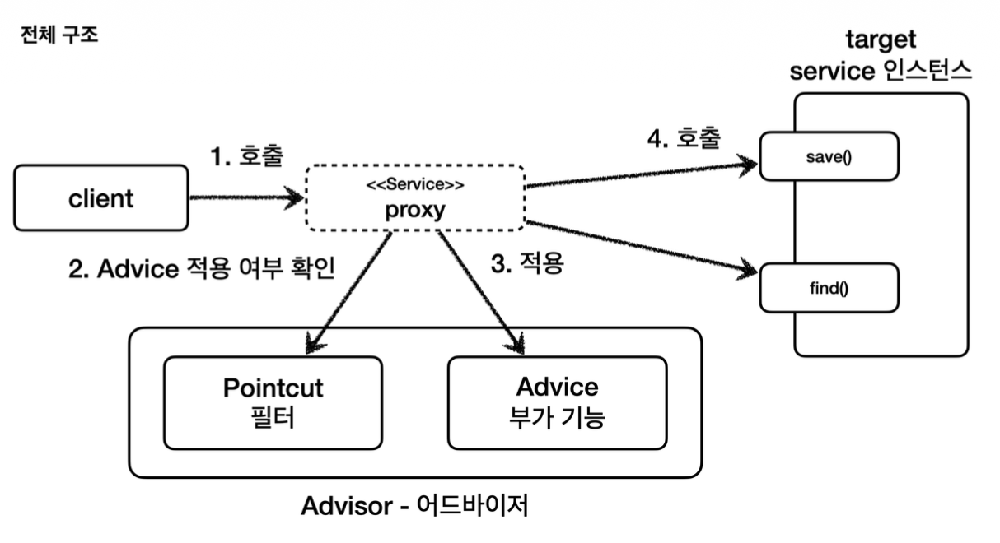
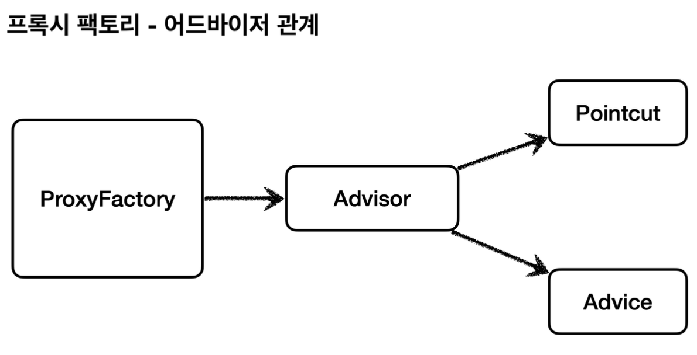

## 들어가며
템플릿 메서드 패턴과, 프록시 패턴을 배우며 기본기를 다졌다. 다음 순서로 스프링에서 지원하는 스프링인 *프록시 팩토리* 를 정리해보려 한다.
인터페이스가 존재하면 JDK 동적 프록시를 사용할 수 있고, 인터페이스가 없는 경우에는 CGLIB 프록시를 사용한다. 프록시 팩토리는 개발자가 직접 프록시 방식을 선택하지 않아도 내부에서 적절한 프록시 구현을 자동으로 결정한다.


## 프록시 팩토리

### 프록시 팩토리가 뭐에요?



스프링에서 제공하는 프록시를 통합해서 편리하게 만들어주는 기능이다.

위에서 언급한 것 처럼 인터페이스가 있으면 JDK 동적 프록시를 사용하고, 구체 클래스만 있다면 CGLIB 를 사용한다.

### 왜 필요할까?

프로젝트를 진행 할 때 컨트롤러 레이어의 경우 인터페이스를 따로 만들지 않는 경우가 많다. 하지만 서비스와 레포지토리 레이어의 경우 대부분 인터페이스를 만들고 구현체를 만든다. 
이 경우 JDK 동적 프록시가 제공하는 `InvocationHandler` 와 CGLIB 가 제공하는 `MethodInterceptor` 를 각각 중복으로 따로 구현해야 할까? 

프록시 팩토리에서는 이러한 문제를 해결해준다. 부가 기능 역할을 하는 `Advice` 를 등록만 해주면 된다. 결과적으로 개발자는 `InvocationHandler` 나 `MethodInterceptor` 를 신경쓰지 않고 `Advice` 만 만들면 된다.

### Advice 란?

템플릿 메서드 패턴, 프록시 패턴, 데코레이터 패턴에서 해오던 **타겟 로직에 언제, 무엇을 끼워 넣을지**에 대한 정의 부분이다.

`org.aopalliance.intercept.MethodInterceptor` 의 구현체를 만들어서 `Advice` 를 만든다. 주의할 점은 CGLIB 의 `MethodInterceptor` 와는 다르다는 것이다.

그리고 내부에 있는 `invoke` 메서드를 오버라이딩 해주면 된다.

``` java
public class LogAdvice implements MethodInterceptor {

    @Override
    public Object invoke(MethodInvocation invocation) throws Throwable {
        System.out.println("before");
        
        Object result = invocation.proceed(); // 타깃 호출
        
        System.out.println("after");
        return result;
    }
}
```

### 포인트컷, 어드바이스, 어드바이저

앞서 설명한 것은 `어드바이스(Advice)` 이다. 나머지 둘인 `포인트컷(Pointcut)`과 `어드바이저(Advisor)` 를 살펴보자.

1. 어드바이스(Advice): 무엇을 할 것인가?
Advice 는 부가 기능 그 자체이다. 타겟 메서드 실행 과정에 끼워 넣을 로직을 의미한다.
2. 포인트컷(Pointcut): 어디에 적용할 것인가?
`Pointcut` 은 `Advice` 를 적용할 대상 메서드를 선별하는 조건이다. 
예를 들어 `save*` 를 추가하면 'save' 로 시작하는 메서드에 적용한다는 것이 된다.

``` java
NameMatchMethodPointcut pointcut = new NameMatchMethodPointcut();
        pointcut.setMappedNames("request*", "order*", "save*");
```

스프링은 많은 포인트컷을 제공한다. 
`NameMatchMethodPointcut`: 메서드 이름을 기반으로 매칭한다. 내부에서는 `PatternMatchUtils` 를 사
용한다.
`AnnotationMatchingPointcut`: 애노테이션으로 매칭한다.
`AspectJExpressionPointcut`: aspectJ 표현식으로 매칭한다.

마지막이 가장 유용하게 사용된다고 한다.

{: start="3"}
3. 어드바이저(Advisor): Advice + Pointcut
하나의 `어드바이저(Advisor)` 는 하나의 `Advice` 와 하나의 `Pointcut` 으로 구성된다.


``` java
//pointcut
NameMatchMethodPointcut pointcut = new NameMatchMethodPointcut();
pointcut.setMappedNames("request*", "order*", "save*");

//advice
LogTraceAdvice advice = new LogTraceAdvice(logTrace);

//advisor = pointcut + advice
return new DefaultPointcutAdvisor(pointcut, advice);
```




## 끝내며

결국 프록시 팩토리는 프록시 생성 책임을 전담하여 프록시 패턴을 실무에서 안전하고 유연하게 사용할 수 있도록 만들어졌다.

하지만 실제 프로젝트에서는 `@Service` `@RestController` 등 어노테이션을 통한 빈 등록을 한다. 이 과정에서 개발자가 직접 프록시 팩토리를 호출하지 않는다.

이 경우에 스프링은 `빈 후처리기(BeanPostProcessor)` 를 통해 기존 빈을 프록시로 감싸서 교체하는 방식을 사용한다.
다음 글에서는 이 빈 후처리기가 어떤 역할을 하는지 정리해보려 한다.