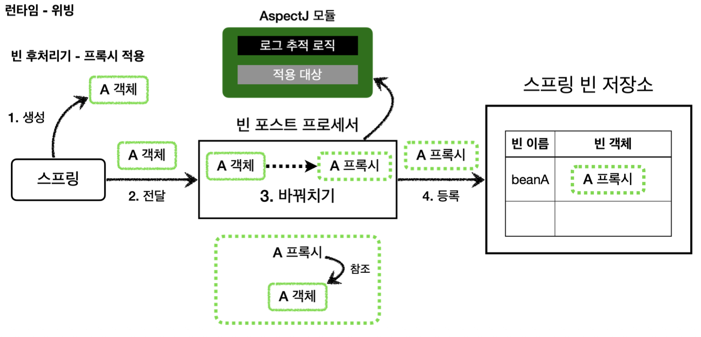
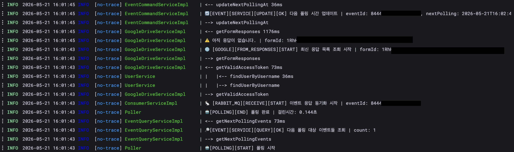

## 문제점
프로젝트를 시작한지 6개월이 지난 시점에서 코드 리팩토링을 시작하게 되었는데, 눈에 띄는 부분이 보였다.

``` java
long startTime = System.currentTimeMillis();
// ... 서비스 로직 ...
long elapsedTime = System.currentTimeMillis() - startTime;
```
실행 시간을 확인하고, 병목 지점을 확인하기 위한 로직이다. 하지만 같은 코드가 모든 서비스 클래스의 필요한 모든 메서드에 존재한다.
핵심 비즈니스 로직은 서비스 코드에, 반복되는 공통 로직은 따로 분리하기 위해서 AOP 를 도입하였다.


## AOP 와 @Aspect

### AOP 란?
"관점 지향 프로그래밍" 이다. 핵심 관심사와 부가 관심사를 분리하고, **핵심 관심사의 코드를 더 깔끔하게 유지할 수 있도록 해주는 개념**이다. 부가 관심사에는 로깅, 보안, 성능 측정 등이 있다.

### 주요 용어 정리
- Aspect: 공통 관심사를 모아둔 클래스
- Join Point: AOP 를 적용할 수 있는 지점
<span style="color:gray">스프링 AOP 에서는 **메서드 실행 시점**을 의미한다.</span>
- Pointcut: 어떤 Join Point 에 AOP 를 적용할지 정하는 조건
- Advice: 실제로 실행되는 부가 기능 로직
- Target: AOP 가 적용되는 실제 객체, Pointcut 으로 결정한다.
- Weaving: Target 의 Join Point 에 Advice 를 적용하는 것.

### Spring AOP 의 동작 방식
AOP 를 사용할 때 세 가지 방식으로 실제 로직에 추가될 수 있다.
컴파일 시점, 클래스 로딩 시점, 런타임 시점(프록시) 이 중에서 스프링 AOP 는 프록시 방식을 사용한다.


### @Aspect 란?
스프링에 프록시를 적용하려면 Pointcut 과 Advice 로 구성된 Advisor 를 만들어서 스프링에 등록하면 된다. 스프링은 `@Aspect` 로 편리하게 advisor 를 생성할 수 있는 기능을 제공한다.

``` java
@Slf4j
@Aspect
public class AspectV6Advice {
@Around("hello.aop.order.aop.Pointcuts.orderAndService()")
public Object doTransaction(ProceedingJoinPoint joinPoint) throws
Throwable {
    try {
      //@Before
      log.info("[around][트랜잭션 시작] {}", joinPoint.getSignature());
      
      Object result = joinPoint.proceed();
      
      //@AfterReturning
      log.info("[around][트랜잭션 커밋] {}", joinPoint.getSignature());
      return result;
      } catch (Exception e) {
      //@AfterThrowing
      log.info("[around][트랜잭션 롤백] {}", joinPoint.getSignature());
      throw e;
      } finally {
      //@After
      log.info("[around][리소스 릴리즈] {}", joinPoint.getSignature());
   }
}
``` 

Pointcut 표현식은 `@Around("{여기에 Pointcut 표현식 작성}")` 여기에 작성한다. 문법이 따로 있으니 찾아보도록 하자.

### Advice 종류
> 위 예시 코드를 보면서 확인하면 이해하기 편하다.

- @Before: joinPoint.proceed() 가 실행되기 전에 실행할 부가 기능
- @After: joinPoint.proceed() 가 실행된 후 실행할 부가 기능
- @AfterReturning: joinPoint.proceed() 가 실행이 완료된 후 실행할 부가 기능
- @AfterThrowing: 에러가 발생했을 때 실행할 부가 기능
- @Around: 메서드 호출 전후에 실행한다. 위의 모든 것을 포함한다.

`@Around` 를 제외한 Advice 는 joinPoint.proceed() 를 실행해줄 필요가 없다. 

``` java
@Before("hello.aop.order.aop.Pointcuts.orderAndService()")
public void doBefore(JoinPoint joinPoint) {
    log.info("[before] {}", joinPoint.getSignature());
}
```

## 실제 적용
로그 트레이싱에 AOP 를 적용하였고, 문제점이었던 실행 시간 역시 같이 표시하였다.


