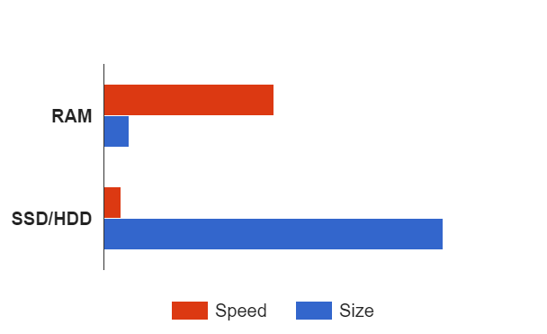
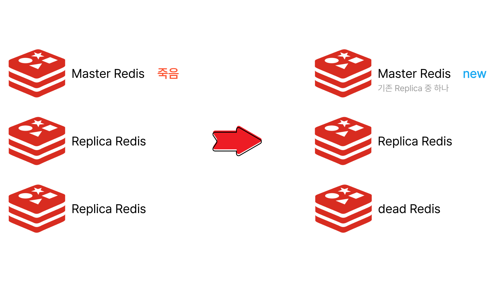
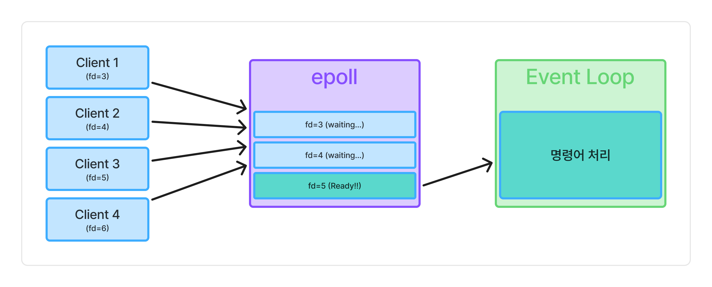
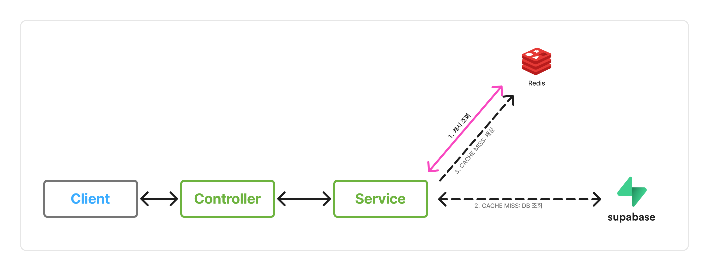
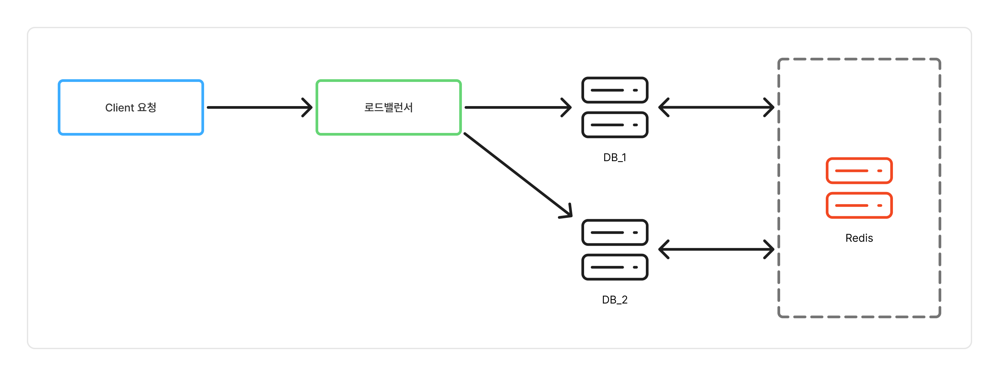
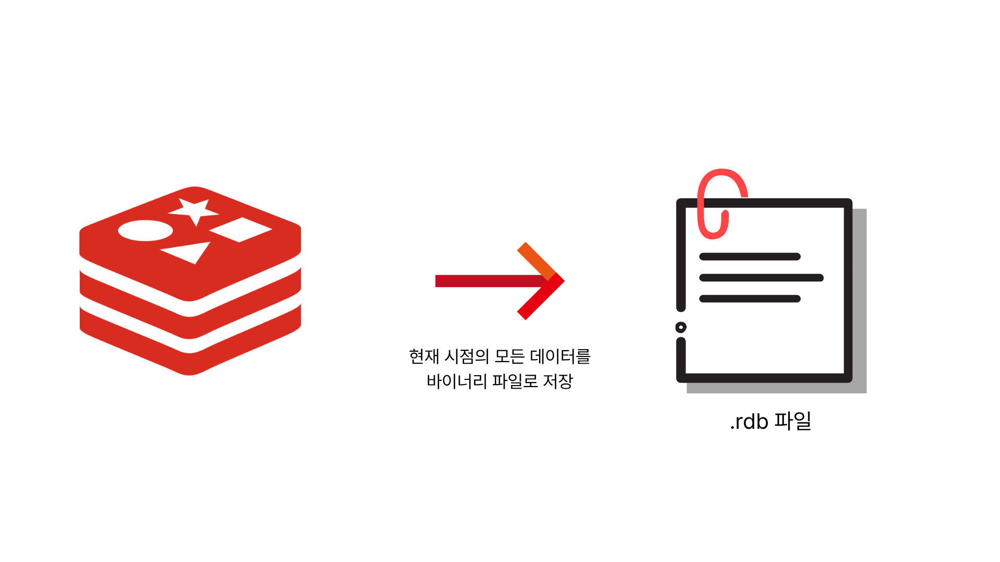
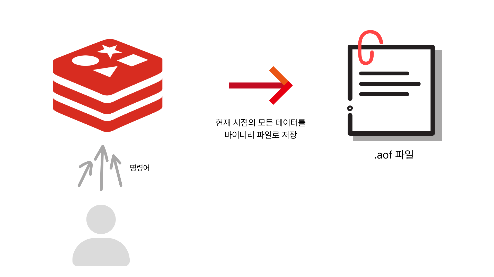

## 들어가며
프로젝트에 Redis 를 도입하며 여러 가지 문제점과 궁금증이 생기며 Redis 에 대해 깊게 알아봐야겠다고 생각하였다. 이 글에서는 Redis 는 무엇인지부터 최적화까지 깊게 알아보려고 한다.

## Redis 에 대하여
### 1. Redis 특징

#### 1-1. 빠른 성능
Redis 는 인메모리 저장소(In-Memory DB)이다. 일반적인 온디스크 데이터베이스는 데이터를 검색할 때 디스크의 데이터를 페이지 단위로 메모리에 올린 뒤 메모리에서 데이터를 찾고, 없는 경우 다시 다른 페이지를 디스크에서 가져와 메모리에 올린 뒤 찾는 과정을 반복한다. 
인메모리 저장소는 모든 데이터가 컴퓨터의 메모리에서 관리된다. 디스크에 접근하는 과정이 필요 없기 때문에 데이터 처리 성능이 굉장히 빠르다는 장점이 있다.

#### 1-2. 단순성
Redis 는 키-값 형태로 데이터를 관리할 수 있는 데이터 저장소이다. 키에 매핑되는 값에는 문자열(String), 해시(Hash), 셋(Set) 등 다양한 데이터 구조를 저장할 수 있도록 지원한다. 그렇기 때문에 추가적인 데이터의 가공 없이 애플리케이션에서 쉽게 사용할 수 있다.
Redis 는 명령어를 싱글스레드로 처리한다. (Redis 6 부터는 네트워크 I/O 에 멀티스레드를 쓸 수 있지만, 명령 실행은 여전히 싱글스레드이다.) 그래서 한 사용자가 오래 걸리는 커맨드를 수행한다면 다른 사용자는 그 쿼리가 완료될 때까지 대기할 수밖에 없다. 기본적으로 Redis 는 빠른 응답 시간을 갖지만 반환이 느린 특정 커맨드만 주의해서 사용해도 장애를 줄일 수 있다.

#### 1-3. 고가용성
Redis 는 High Availability 기능을 제공한다. 복제를 통해 데이터를 여러 Redis 서버에 분산시킬 수 있고, 센티널은 장애 상황을 탐지해 자동으로 fail-over를 시켜준다.
> Fail-over 는 현재 동작 중인 서버가 장애로 죽었을 때, 다른 서버가 자동으로 역할을 이어받는 것이다.

#### 1-4. 확장성
Redis 에서 클러스터 모드를 사용하면 손쉽게 수평 확장이 가능하다. 데이터는 레디스 클러스터 내에서 자동으로 샤딩된 후 저장되고, 여러 개의 복제본이 생성될 수 있다. 이 데이터 분리는 데이터베이스 레이어에서 처리되고, 애플리케이션은 대상 데이터가 어떤 샤드에 있는지 신경 쓰지 않아도 되므로 Redis 를 사용할 때와 동일하게 데이터를 가져오고 저장할 수 있다. 

 

### 2. Redis 가 빠른 이유
> "싱글스레드여서 빠른 것이 아니라 싱글스레드여도 빠를 수 있게 설계했다."

#### 2-1. 멀티스레드의 오버헤드
멀티스레드의 고질적인 문제인 '공유 데이터'에 대한 접근이다. 여러 스레드가 동시에 같은 데이터를 수정하면 문제가 생기기 때문에 Lock 혹은 Mutex 를 건다.
여기서 Lock 을 쓰면 'Context Switching', 'Lock 획득 대기', 'Cache Coherence', 'Race Condition' 이런 비용이 생긴다.

Redis 는 싱글 스레드 구조로 처음부터 경쟁이 없는 구조로 만들었다. 또한 스레드 전환마다 레지스터, 스택, 캐시를 저장/복원 하는 Context Switching 비용이 없어진다. Context Switching 의 경우 요청이 많을수록 오버헤드가 누적된다.

`스레드 증가 -> 처리량 선형 증가` 이 공식은 공유 데이터가 없을 때만 성립한다.

#### 2-2. 싱글스레드를 선택한 이유
1. CPU가 병목이 아니었다.
Redis 의 실제 병목은 **메모리 대역폭**과 **네트워크 I/O** 이다. CPU 코어를 더 써도 이 부분은 해결되지 않는다.

2. 단순함이 우선이었다.
Lock, Race Condition, Deadlock 이 처음부터 없으면 코드가 근본적으로 단순해져서 개발 속도가 빨라진다.

3. 얻을 것보다 잃을 것이 많다.
얻는 것보다 복잡성이 크다. 대신 여러 인스턴스로 수평 확장할 수 있게 하였다.

#### 2-3. 디스크 I/O 가 필요 없다
위에서 살펴봤듯이 RAM 과 HDD 의 속도 차이는 굉장히 크다. DB는 필요한 데이터가 캐시에 존재하지 않으면 디스크에서 데이터를 가져온 후 메모리에 올린 뒤에 처리해야 한다. RAM 에 비해 디스크 I/O 는 훨씬 느리기 때문에 전체 조회 시간이 크게 증가할 수 있다.

하지만 RAM 의 경우 휘발성 메모리이기 때문에 컴퓨터 재시작 시 데이터가 유실될 수 있다. 이 또한 RDB 스냅샷과 AOF 로그로 보완하였다.

#### 2-4. I/O Multiplexing
위에서 Redis 의 실제 병목은 '네트워크 IO' 라고 했다. 그래서 요청 데이터가 먼저 도착한 소켓 먼저 처리한다.

#### 2-5. 메모리 구조
Redis 는 key 를 해시 테이블 기반으로 관리한다. 해시 충돌이 발생하면 같은 bucket 안에서 연결하여 충돌을 처리한다. 또한 value 는 Redis 자료형에 따라 내부적으로 최적화된 자료구조로 관리된다.

#### 2-6. O(1) 의 자료구조 설계
대부분의 연산이 상수 시간에 완료된다.

#### 2-7. RESP 프로토콜
> "길이를 먼저 알려주면 스캔이 필요 없다."

일반적인 방식은 `SET,hello,world` 에서는 쉼표가 나올 때까지 스캔을 하고 읽으면서 파악을 하기 때문에 버퍼를 미리 할당하지 못하고, 이는 곧 메모리 낭비가 된다.
RESP 방식은 인자의 크기와 다음번에 나오는 명령의 크기를 알려준다. 스캔이 없고 버퍼 크기를 미리 확정할 수 있다. 파싱 루프가 단순해지고 오버헤드가 줄어든다.

#### 2-8. Pipeline & Batch

> "N 번의 왕복을 1 번으로"

Redis 는 여러 개의 명령어를 한 번에 묶어서 보내는 Pipeline 이라는 기능을 제공하고 있다. 네트워크 지연 시간(RTT)이 1ms 인 환경에서 명령어가 500개 있다면 500ms 이겠지만, 한번에 묶어서 보내면 1ms 가 된다. 
파이프라인을 사용하지 않을 때는 약 70,000~180,000 req/sec 의 처리량을 보였다면 파이프라인을 사용했을 때는 GET 181만, SET 153만 req/sec 의 처리가 가능하다.

### 3. Redis 의 핵심 자료구조

#### 3-1. String
- 일반적인 문자열
- 값은 최대 512MB 이며 String 으로 될 수 있는 binary data 혹은 JPEG 이미지도 가능하다.

#### 3-2. Bitmaps
- String 의 변형이다.
- bit 단위 연산이 가능하다.
- String 과 같이 512MB(2^32 bit) 까지 사용 가능하다.
- 저장 시, 저장 공간 절약에 장점이 있다.

#### 3-3. Lists
- Linked List 형식의 데이터 구조이다.
- Head / Tail 추가/삭제가 빠르다.
- Message Queue 로 사용하기 적합하다.

#### 3-4. Hashes
- 하나의 Key 안에 여러 개의 field-value 쌍을 저장한다.
- Redis 안에 작은 객체 하나를 저장할 때 많이 사용한다.

#### 3-5. Sets
- 중복된 데이터를 담지 않기 위해서 사용한다.
- 모든 데이터를 전부 다 가져올 수 있는 명령이 있으므로 주의해서 사용해야 한다.

#### 3-6. Sorted Set
- 중복 없는 값들을 저장하지만, 각 값에 score 개념을 붙여 정렬한다.
- 오름차순으로 내부 정렬을 한다.
- 값은 중복될 수 없지만, score 는 중복이 가능하다.
- score 값이 같으면 사전순으로 정렬한다.

#### 3-7. Streams
- log 를 저장하기 가장 좋은 자료구조이다.
- append-only 이고 중간이 변경되지 않는다.

### 4. Redis 의 사용 사례

#### 4-1. 캐싱

캐싱은 반복적으로 조회되는 데이터를 매번 데이터베이스에서 가져오지 않고, 한 번 조회한 데이터를 Redis 에 저장해두었다가 재사용하는 방식이다. Redis는 메모리 기반 저장소이기 때문에 데이터베이스보다 빠르게 데이터를 조회할 수 있다.

만약 동일한 데이터를 요청할 때마다 매번 데이터베이스를 조회한다면 응답 속도가 느려지고, 데이터베이스에 부하가 집중될 수 있다. 트래픽이 많은 서비스에서는 이러한 부하가 누적되어 장애로 이어질 가능성도 있다. Redis를 캐시로 사용하면 자주 조회되는 데이터를 빠르게 제공할 수 있어 응답 속도를 개선하고 데이터베이스의 부하를 줄일 수 있다.

캐싱을 사용할 때는 적절한 TTL(Time To Live) 설정이 중요하다. TTL이 너무 짧으면 캐시된 데이터가 빠르게 만료되어 다시 데이터베이스를 조회하는 경우가 많아지고, 캐시 효율이 떨어진다. 반대로 TTL이 너무 길면 더 이상 필요하지 않거나 오래된 데이터가 Redis에 남아 메모리를 불필요하게 차지할 수 있다.

따라서 데이터의 변경 빈도와 조회 빈도를 고려해 적절한 TTL을 설정하는 것이 중요하다.

#### 4-2. 세션 저장소

웹 서비스에서는 사용자의 인증 정보를 일정 시간 유지해야 한다. 이때 서버는 사용자의 세션 정보를 저장하고, 이후 요청이 들어올 때마다 해당 세션을 확인해야 한다.
만약 세션 저장소가 일반적인 DB 라면 디스크 I/O 가 많아지기 때문에 서버의 부하가 상당히 커질 것이다. 하지만 Redis 는 인메모리 기반으로 디스크 I/O 를 하지 않기 때문에 상당히 빠르게 처리할 수 있다. 

#### 4-3. 랭킹 저장소

Redis 를 사용하면 랭킹 데이터를 빠르게 조회할 수 있다. 데이터베이스에서 매번 조회 후 정렬을 하면 데이터가 많아질수록 부담이 커진다. 반면 Redis 의 Sorted Set 의 경우 정렬을 유지하므로 사용자 N 명 조회 혹은 상위 N 명 조회에 적합하다.

물론 실시간 랭킹에도 유리하다. 사용자 점수가 변경될 때마다 Redis 에 반영하면 최신 랭킹도 조회할 수 있다.

#### 4-4. 메시지 큐
Redis Queue 를 List 로 구현하여 Message Broker 로 사용할 수 있다. Redis Queue 의 경우 Linked List 처럼 앞, 뒤의 연산은 O(1) 시간복잡도를 가지기 때문에 Message Broker 로 사용하기에 적합하다.
다만 안정적인 재처리나 소비자 그룹 관리가 필요하다면 Redis Stream 또는 Kafka, RabbitMQ 같은 전문 메시지 브로커를 고려해야 한다.

### 5. Redis 의 영속성

#### 5-1. RDB

> 스냅샷: 특정 시점의 메모리에 있는 데이터를 바이너리 파일로 저장한다는 의미

특정 시점의 Redis 데이터를 통째로 스냅샷처럼 저장하는 방식
Redis 가 꺼졌다가 다시 켜지면 RDB 파일을 읽어서 데이터를 복구한다.

RDB 방식은 속도가 빠르다는 장점이 있다. 하지만 스냅샷을 추출하는 데에 오래 걸리고 도중에 Redis 가 꺼지면 마지막 스냅샷 이후의 데이터가 사라진다.

수십 GB 는 몇 분 이상 소요될 수 있다고 한다.

#### 5-2. AOF

AOF 방식은 redis 의 모든 쓰기 연산(save/update/delete)을 모두 log 파일에 기록한다.
그리고 Redis 가 꺼졌다가 다시 켜지면 log 파일에 기록된 모든 쓰기 연산을 다시 실행하여 데이터를 복구한다.

AOF 의 저장 방식의 프로세스는 다음과 같다.

1. Client 가 Redis 에 쓰기 명령어를 보낸다.
2. 명령어를 수행한다.
3. AOF 파일에 해당 명령어를 기록한다.

RDB 방식과는 다르게 실시간성을 갖는다. 즉 Redis 가 다운되어도 데이터 유실이 거의 없다는 장점이 존재한다. (기본 설정인 `appendfsync everysec` 에서는 최대 1초 분량이 유실될 수 있다.) 하지만 log 파일에 남기 때문에 데이터 양이 굉장히 크고, 모든 연산을 다시 실행하기 때문에 복구 속도도 느리다.

## 마치며

Redis 는 빠른 읽기/쓰기와 다양한 자료구조를 제공하는 인메모리 저장소이다. 단순 캐시 뿐만이 아니라 여러 상황에서 사용할 수 있다.
Redis 를 잘 사용하기 위해서는 '빠르다'만 볼 것이 아니라 어떤 데이터를 얼마나, 어떻게 저장 및 처리할지 설계해야 한다.
