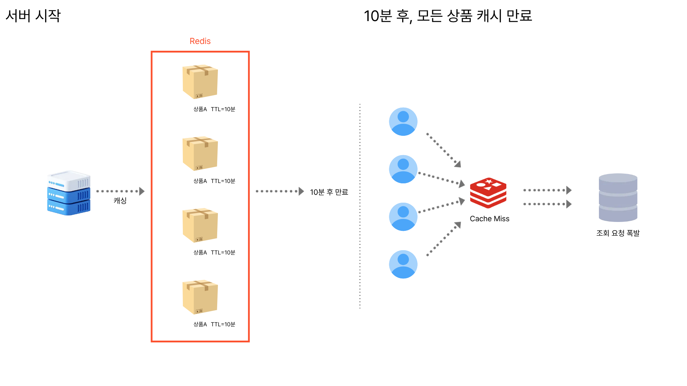
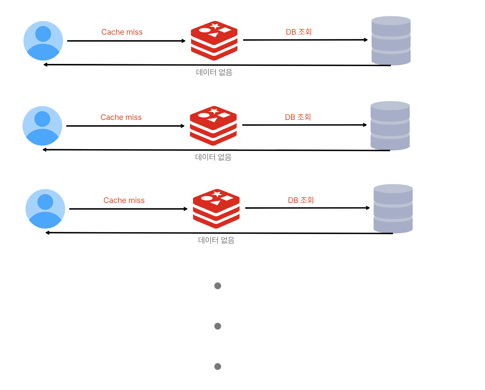

캐시 관통과 캐시 쇄도에 대해 공부하면서 토스 기술 블로그의 글을 읽었습니다. 이 글에서는 기존 내용을 다시 요약하기보다, 두 문제를 어떻게 구분해서 이해했는지와 실제 서비스에서는 어떤 흐름으로 문제가 발생하는지를 중심으로 정리해 보려고 합니다.

캐시를 도입했을 때 DB의 부하가 줄어든 것은 사실이고, 안정적인 서비스 운영이 가능해졌습니다. 하지만 캐시를 도입해도 DB에 부하가 생겨 서비스에 장애가 발생할 수 있어요. 이 글에서는 두 가지 상황에 대해서 설명하려고 합니다.

## 1. 캐시 쇄도(Cache Stampede)
캐시 미스가 동시에 많이 발생하는 경우를 의미합니다. 많은 캐시의 만료 시간을 똑같이 했을 때 많이 생기는 현상입니다. 

예를 들어 쇼핑몰을 운영한다고 생각해봅시다. 저희는 상품에 대한 조회 트래픽이 엄청나서 서버 시작 시점에 상품들을 캐싱합니다. 이 때 TTL을 10분으로 하였다면, 10분 뒤에 거의 동시에 만료가 됩니다.




그럼 만료가 되었을 때 사용자들이 동시에 요청을 하게 되면 어떻게 될까요? 동시에 요청한 사용자들은 모두 Cache Miss 가 되어 모든 요청이 DB를 향하게 됩니다.

이 경우를 '캐시 쇄도(Cache Stampede)' 라고 합니다. 
다시 정의를 하자면 캐시 쇄도는 다수의 캐시가 비슷한 시점에 만료되면서, 해당 요청들이 한꺼번에 DB로 몰리는 현상이라고 할 수 있습니다.


### 해결 방법: 지터(Jitter)
지터(Jitter) 개념을 적용하여 캐시 쇄도를 어느 정도 완화할 수 있습니다.
지터는 모든 캐시에 동일한 TTL 을 부여하는 것이 아닌, 기본 TTL 에 임의의 값을 빼거나 추가합니다.

예를 들어 TTL 이 10분이라면 여기에 0~10초 사이의 임의의 값을 추가합니다.
- 상품 A: 10분2초
- 상품 B: 10분5초
- 상품 C: 10분1초
- 상품 D: 10분8초

캐시가 만료되는 시점이 분산되어 특정 순간에 DB로 요청이 몰리는 상황을 줄일 수 있습니다.
다만 지터가 길어질수록 오래된 정보를 보여주게되므로 서비스의 성격에 맞는 지터 설정이 필요합니다.

## 2. 캐시 관통(Cache Penetration)
Redis 를 배우고 처음 적용할 때는 데이터를 캐싱하여 응답 시간과 DB 부하를 줄입니다. 하지만 값이 없는 정보 `null` 은 캐싱하지 않습니다. 그렇다면 값이 없다는 정보를 캐싱하지 않으면 어떤 문제가 생길까요?



데이터베이스에서 조회를 했는데도 캐싱되지 않는 상황을 캐시 관통이라고 합니다. 
예를 들어서 상품이 1번부터 10,000번까지 존재하는 쇼핑몰이 있다고 가정해볼게요. 사용자가 존재하지 않는 상품인 999,999번을 조회하면 캐시에서는 데이터가 없어서 `Cache Miss` 가 발생합니다. 이어서 DB를 조회하지만, DB에도 데이터가 없어 요청은 그대로 종료됩니다.

문제는 동일한 요청이 다시 들어왔을 때입니다.

해당 데이터는 캐싱되지 않았기 때문에 다음 요청에서도 `Cache Miss` 가 발생하고, 다시 DB를 조회합니다. 
이러한 요청이 대량으로 발생하면 캐시를 도입했음에도 DB에 지속적인 부하가 발생할 수 있습니다.

### 해결 방법: 빈 값 캐싱
DB 조회 결과가 존재하지 않더라도 `값이 없음` 정보를 캐싱하는 것입니다. 

예를 들어 999,999번 상품을 조회했지만 DB에 없다면, Redis에 해당 상품이 존재하지 않는다는 표시 값을 저장합니다. 

``` Json
{
  key: product: 999999,
  value: 음수 최솟값,
  TTL: 1분
}
```
이후 동일한 요청이 들어오면 DB까지 조회하지 않고 캐시에서 데이터가 존재하지 않는다는 응답을 반환할 수 있습니다.

## 정리

캐시 쇄도와 캐시 관통을 정리하며 Redis를 배우고 단순히 캐시를 추가하는 것이 아니라, 만료 정책과 예외 상황까지 함께 설계해야 대용량 트래픽 환경에서도 안정적으로 운영을 할 수 있음을 알게 되었어요.
물론 이 두 상황만 존재하는 것이 아니기에 계속 배우면서 정리할 예정이에요.


