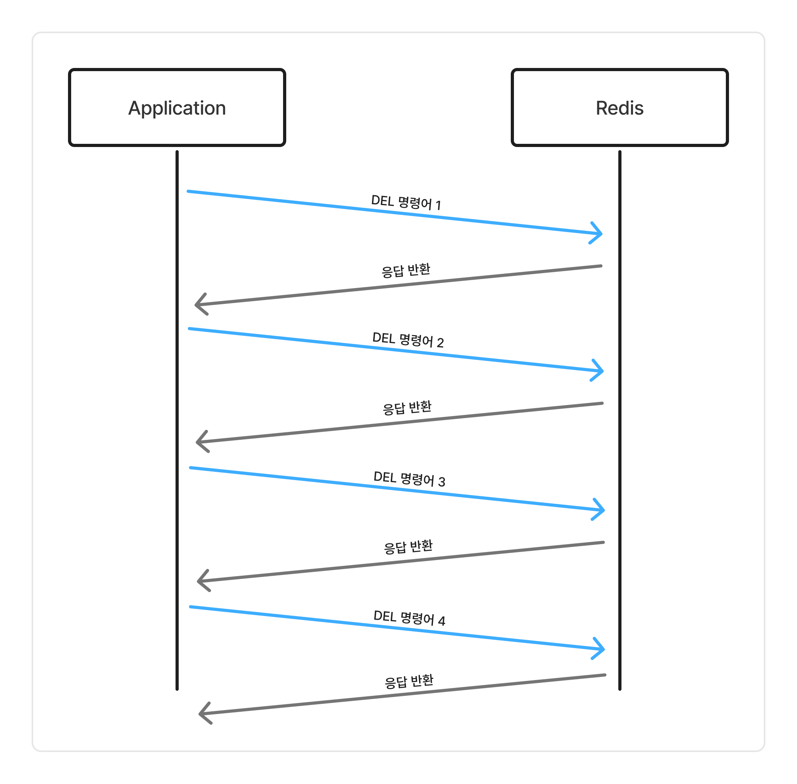

특정 API에 요청이 들어오면 네 개의 캐시를 무효화해야 하는 로직이 있었습니다. 각 캐시를 개별적으로 삭제했기 때문에 Redis에 총 네 번의 요청이 전송되었고, 그만큼 네트워크 왕복 비용(RTT)도 네 차례 발생했습니다.

이 문제를 해결하고자 Redis 파이프라이닝 기법을 적용했습니다. 여러 명령어를 한 번에 전송하면 RTT를 줄일 수 있으므로, 당연히 성능 개선이 이루어질 것이라고 예상했습니다.
하지만 적용 전후의 성능 측정 로그를 비교한 결과, 파이프라이닝을 적용한 이후 처리 시간이 약 4배 느려졌습니다. 여기서 "네 번 나누어 보내던 명령을 한 번에 전송하는데 왜 느려졌지?"라는 의문이 들었습니다.

이 현상을 이해하기 위한 시간을 가지게 되었고, 이 글에서 제가 이해한 것을 최대한 이해하기 쉽게 정리하려고 합니다.

## 1. 기존의 문제: "네 개의 캐시, 네 번의 왕복"



기존 로직에서는 네 개의 캐시를 삭제하기 위해 DEL 명령을 각각 호출했습니다. 일반적으로 각 명령의 응답을 기다린 뒤 다음 명령을 수행하여, 네 개의 명령에 대해 네 번의 네트워크 왕복 비용이 발생합니다.

### 1-1. 파이프라이닝을 선택한 이유
여러 캐시를 한 번에 처리하는 방법으로 다중 키 명령과 파이프라이닝을 고려했습니다. 당시에는 수행할 명령이 늘어나도 유연하게 확장 가능하다는 점에서 파이프라이닝을 선택했습니다.

## 2. 예상과 반대였던 성능 측정 결과
캐시 무효화에 걸리는 시간을 측정해보았습니다.

|  | 측정 결과 |
|---|---|
| **적용 전** | 7.81ms |
| **적용 후** | 30.70ms |

파이프라이닝을 적용하면 네 개의 명령을 한 번에 보내어 RTT가 줄어들어 처리 시간도 4배 정도 단축될 것이라고 예상했습니다. 하지만 실제 측정 결과 파이프라이닝 적용 후 처리 시간은 30.70ms로 약 3.9배 증가했습니다.

## 3. 일반 연결과 전용 연결
Lettuce(Spring Data Redis)에는 일반 연결과 전용 연결이 존재합니다. 단일 Redis 명령의 경우 일반 연결을 사용하고, 파이프라인은 전용 연결을 사용합니다. 

이렇게 나누어져 있는 이유를 간단하게 설명하겠습니다. 일반적인 `GET`, `SET`, `DEL`은 각각 독립적으로 실행되어 여러 요청이 하나의 연결을 공유해도 문제가 없습니다. 하지만 파이프라이닝의 경우 특정 연결 상태가 유지되거나 오랫동안 연결을 점유할 수 있기 때문입니다.

### 3-1. 전용 연결이 관리하는 상태들
전용 연결에서 관리하는 상태는 다음과 같습니다.

- 현재 파이프라인 실행 중인지
- 어떤 명령이 파이프라인에 포함됐는지
- 언제 명령을 flush 할지
- 언제 모든 결과를 기다릴지

등등 다양한 상태를 관리하고 있습니다. 공유 연결에서 이 상태를 사용하면 다른 요청이 보내는 Redis 명령까지 같은 파이프라인에 섞일 수 있습니다.

## 4. 진짜 병목: 풀링되지 않은 전용 연결
느려진 원인은 파이프라인 메서드가 매번 별도 Redis 연결을 생성하기 때문이었습니다. 풀링이 되지 않았을 때는 사실상 요청마다 새로 연결을 생성합니다.

다음과 같은 프로세스를 매번 거치게 됩니다.

``` text
전용 Redis 연결 생성
-> TCP/TLS 연결
-> Redis 인증
-> 명령어 실행
-> 결과 대기 및 역직렬화
-> 전용 연결 종료
```

Redis 도 로컬이 아니라 원격 Upstash 이므로 연결 및 인증 비용이 크게 나타났습니다.

### 4-1. 왜 기존 네 번의 명령이 더 빨랐을까?

#### 공유 연결 재사용
개별 DEL 명령은 애플리케이션이 이미 생성한 공유 연결을 재사용합니다. 각 명령을 실행할 때마다 RTT는 발생했지만, 새로운 TCP/TLS 연결을 생성하거나 인증하는 비용은 발생하지 않았습니다.

#### 오버엔지니어링
파이프라이닝은 많은 명령을 처리할 때 반복되는 네트워크 왕복 비용을 줄이는 데 효과적입니다. 하지만 이번 로직에서 실행한 명령은 단 네 개입니다. 여기에 전용 연결 생성 비용까지 더해지면서 파이프라이닝의 장점을 활용할 수 없었습니다.

결국 이번 사례에서 파이프라이닝 도입은 해결하려는 문제의 규모에 비해 복잡성과 비용만 늘린 오버엔지니어링이었습니다.

### 4-2. 연결 풀을 적용하면 해결될까?
`commons-pool2` 의존성을 추가하고 간단한 설정을 하면 풀링을 할 수 있습니다. 풀링을 적용하면 기존 개별 명령을 수행하는 것보다 빠르지만, 애초에 규모가 작아 드라마틱하게 빨라지지는 않습니다. 

실제로 연결 풀을 적용한 결과를 보여드리겠습니다.

|  | 측정 결과 |
|---|---|
| **개별 명령어** | 7.81ms |
| **풀링 적용 전** | 30.70ms |
| **풀링 적용 후** | 4.79ms |

개별 명령어보다 약 1.63배 빠른 결과를 확인할 수 있었습니다. 이를 통해 파이프라이닝 자체가 느린 것이 아닌 전용 연결을 매번 새로 생성한 것이 주요 원인이었음을 확인할 수 있었습니다.

## 5. 이 사례에서 더 적합한 방법: 다중키
서로 다른 종류의 명령을 실행하는 것이 아닌, 네 개의 캐시 키에 동일한 명령을 수행하는 로직이었습니다. 이런 경우에는 파이프라이닝보다 하나의 명령에 여러 키를 전달하는 다중 키 방식이 더 적합했습니다.

다중 키 명령을 사용하면 별도의 오버헤드가 필요하지 않고, 하나의 명령과 한 번의 RTT만으로 여러 키를 삭제할 수 있습니다.

결국 이번 사례에서는 파이프라이닝보다 구조가 단순하고 오버헤드도 적은 다중 키 명령이 더 적절한 선택이었습니다.

## 6. 파이프라이닝은 언제 사용해야 할까?
파이프라이닝은 많은 명령을 처리해야 하고, 각 명령의 응답을 기다리는 네트워크 왕복 비용이 클 때 효과적입니다.

특히 조회, 저장, 삭제처럼 서로 다른 종류의 명령을 대량으로 실행하면서 각 명령의 결과가 다음 명령에 영향을 주지 않는 경우 적합합니다. 

정리하면 파이프라이닝은 다음과 같은 상황에서 이점을 얻을 수 있습니다.

- 대량의 명령을 실행하는 경우
- Redis 서버와의 RTT가 큰 경우
- 명령 간의 결과 의존성이 없는 경우
- 연결 재사용 또는 커넥션 풀이 준비된 경우

## 7. 마치며: 왕복 횟수만 줄인다고 항상 빨라지는 것은 아니다.
처음에는 네 번의 RTT를 한 번으로 줄이면 당연히 성능이 좋아질 것이라고 예상했습니다. 하지만 실제 성능은 명령의 수나 RTT만으로 결정되지 않았습니다. Redis 연결이 어떻게 생성되고 재사용되는지, 전용 연결의 생명주기도 함께 확인했어야 했습니다.

그리고 RedisTemplate과 같이 추상화된 API를 사용하기만 했지만, 이번 사례에서는 그 아래에서 Lettuce가 기본 연결과 파이프라인을 어떻게 처리하는지 이해하는 과정이 필요했습니다.
추상화는 사용을 편리하게 만들어 주지만, 성능 문제가 발생했을 때는 내부 동작을 확인해야 원인을 찾을 수 있습니다. 

이번 사례에서는 결국 최적화에서 중요한 것은 현재 문제에 가장 알맞은 방법을 선택하는 것이라는 점을 배울 수 있었습니다.


