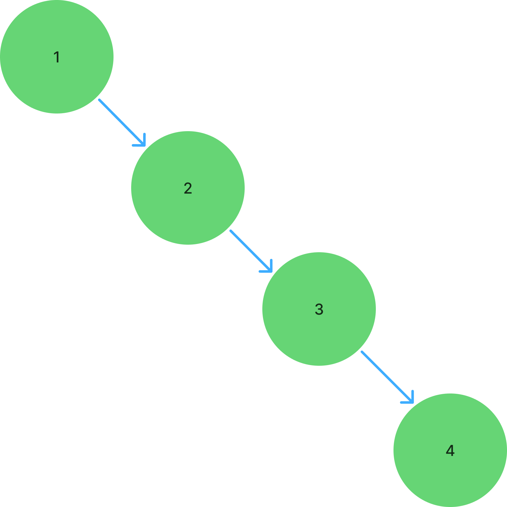
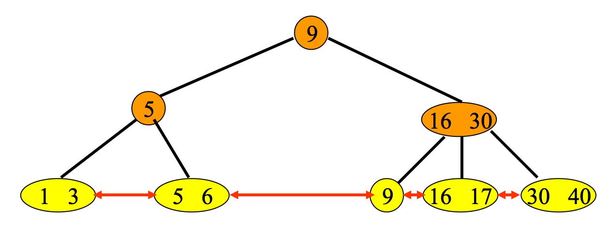

## 들어가며
데이터베이스에서 인덱스를 추가하면 조회 성능이 높아진다는 것은 알고 있었습니다. 하지만 인덱스가 내부에서 어떤 자료구조를 사용하는지, 그리고 왜 그 자료구조를 사용하는지에 대해서는 깊게 생각해보지 않았습니다.

학교 후배들에게 멘토링을 진행해주며 B-Tree 와 B+Tree 에 대해서 복습하게 되었고, 데이터베이스는 어떤 식으로 이 자료구조를 사용하는지 궁금해졌습니다.

이를 이해하기 위해서 단순히 시간 복잡도만 비교하지 않고 데이터베이스가 데이터를 저장하고 읽는 방식과 Disk I/O 비용까지 함께 살펴볼 필요가 있었습니다.

이번 글에서는 B-Tree 와 B+Tree 의 구조를 살펴보고 이러한 구조가 데이터베이스 인덱스에 적합한 이유를 정리해보려고 합니다.

## 1. Binary Search Tree 로는 부족한가?
BST의 문제점은 한쪽으로만 가지가 뻗어져 나가면 탐색의 시간 복잡도가 최악의 경우 O(N) 이 될 수 있다는 것입니다.

물론 AVL Tree 같은 방법을 사용하면 이러한 문제를 해결할 수 있습니다. 트리의 균형을 유지하기 때문에 탐색, 삽입, 삭제를 O(log N) 으로 수행할 수 있습니다.

균형 잡힌 BST 역시 O(log N) 의 탐색이 가능한데 데이터베이스는 왜 B-Tree 계열의 자료구조를 사용할까요? 이 이유를 이해하기 위해서는 시간 복잡도뿐만 아니라 데이터를 읽을 때 발생하는 Disk I/O 비용을 함께 살펴봐야 했습니다.

## 2. DB는 트리의 높이가 중요하다
데이터베이스에서는 데이터를 Disk 에 저장합니다. 여러분도 아시겠지만 메모리에서 데이터를 읽는 것과 비교하면 Disk 에서 데이터를 읽는 것은 훨씬 큰 비용이 발생합니다. 즉, 비교 연산을 몇 번 수행하는지보다는 데이터를 찾기 위해서 Disk 에 몇 번 접근하는지가 중요했습니다.

BST의 경우는 2개의 자식만 가질 수 있기에 데이터 개수가 많아질수록 트리의 높이가 계속 증가합니다. 반면에 B-Tree 와 같은 Multiway-Tree 는 하나의 노드가 여러 개의 Key 와 자식을 가질 수 있기 때문에 훨씬 낮은 높이의 트리를 만들 수 있습니다.

트리의 높이가 낮다는 것은 원하는 데이터를 찾기 위해 방문해야 하는 노드의 개수가 줄어든다는 의미이고, Disk I/O 횟수를 줄일 수 있다는 의미였습니다.

이러한 이유로 하나의 노드가 많은 자식을 가질 수 있는 B-Tree 계열의 자료구조가 데이터베이스 인덱스에 적합했습니다.

## 3. B+Tree 와 B-Tree 는 무엇이 다를까?
이 두 Tree는 전체적인 구조는 비슷하지만 데이터를 저장하는 위치와 Leaf 노드의 연결에서 중요한 차이가 있습니다.

### B-Tree
내부 노드와 Leaf 노드 모두에 실제 데이터 또는 데이터를 가리키는 정보를 저장합니다. 원하는 Key를 내부 노드에서 발견한다면 바로 탐색을 종료할 수 있습니다.

### B+Tree
반면에 B+Tree 에서는 내부 노드를 탐색을 위한 Key만 저장하는 공간으로 사용하고 실제 데이터는 Leaf 노드에 저장합니다. 내부 노드는 데이터가 어느 방향에 있는지 알려주는 이정표 역할이었습니다.


B-Tree 에서는 Leaf 노드가 독립적이었지만 B+Tree에서는 Leaf 노드를 Linked List 처럼 순서대로 연결했습니다. 이러한 구조 때문에 B+Tree 에서는 특정 범위의 데이터를 연속해서 읽는 작업도 효율적으로 수행할 수 있었습니다.

## 4. B+Tree 와 SQL 문법

예를 들어서 다음과 같은 쿼리를 생각해낼 수 있습니다.

```sql
SELECT * FROM member
WHERE age BETWEEN 20 AND 30;
```
나이가 20부터 30까지 연속된 데이터를 찾아야 할 때 B+Tree 에서는 처음 20을 찾은 이후 Leaf 노드를 순서대로 이동하면서 데이터를 읽으면 됩니다. 

범위 탐색에 매우 유리하다는 것을 알 수 있습니다.

## 5. 그래서 DB 인덱스에 B+Tree 가 적합하다!
B+Tree 는 데이터베이스가 원하는 특성을 대부분 가지고 있습니다.

1. 트리의 높이가 낮다
한 노드가 많은 자식을 가질 수 있기 때문에 Disk I/O 횟수를 줄일 수 있습니다.
2. 항상 균형을 유지한다
최악의 경우에도 일정한 탐색 성능을 유지할 수 있습니다.
3. 범위 검색에 강하다
Leaf 노드가 연결되어 있기 때문에 연속된 데이터를 빠르게 탐색할 수 있습니다.
4. 정렬된 상태를 유지한다.

## 6. 실제 데이터베이스에서는?
중요한 점은 모든 DB가 B+Tree 를 그대로 구현하는 것은 아닙니다.
대부분의 관계형 데이터베이스는 B-Tree/B+Tree 계열의 자료구조를 기반으로 정렬된 인덱스를 구현한다고 이해하는 게 좋습니다.

---
## 마치며
데이터베이스에서는 시간 복잡도만 중요한 것이 아니라 Disk I/O 를 줄이는 것이 중요하다는 점과 B+Tree 의 Leaf 노드 연결 구조가 범위 탐색에 유리하다는 점을 알게 되었습니다.

이제는 단순히 인덱스를 사용하는 것에서 끝나지 않고, 적절한 인덱스를 설계하는 등 실제 데이터베이스 성능 튜닝에도 도전해보고 싶다는 생각이 들었습니다.

앞으로는 쿼리가 어떻게 실행되는지, 인덱스가 언제 사용되고 언제 오히려 비효율적일 수 있는지까지 공부하면서 데이터베이스를 조금 더 깊게 이해해보려고 합니다.