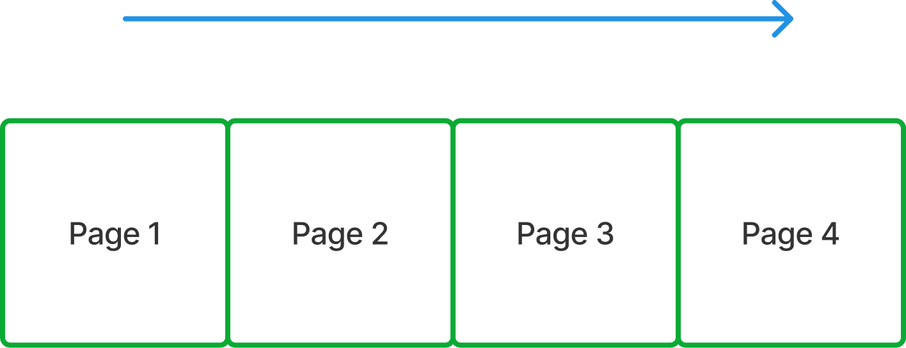
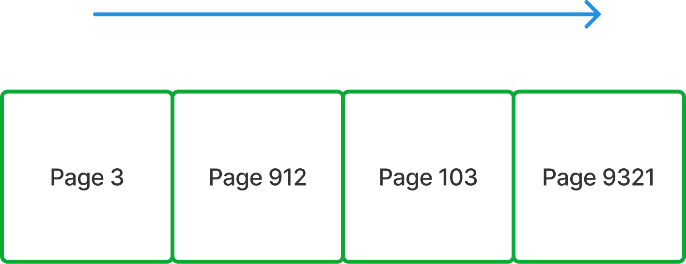
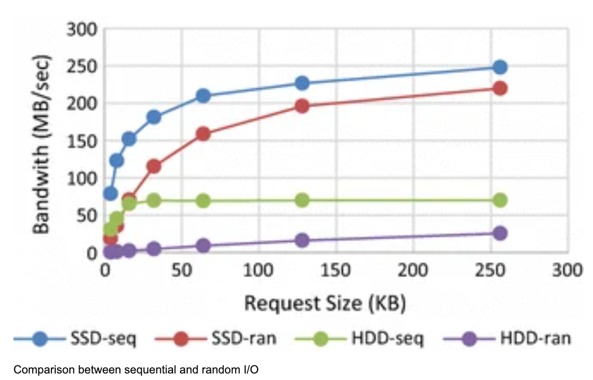
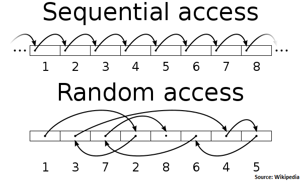

## 들어가며
지난 글에서 DB 인덱스가 B+Tree 계열 자료구조를 사용하는 이유에 대해서 알아봤습니다. 그리고 그 과정에서 Disk I/O 비용도 함께 봐야한다고 언급을 했었습니다.

데이터베이스는 필요한 데이터를 읽을 때 순차I/O 또는 랜덤 I/O 방식으로 접근합니다. 그리고 어떤 방식으로 데이터를 읽느냐에 따라서 성능에 큰 차이가 발생할 수 있습니다.

이번 글에서는 순차I/O 와 랜덤I/O 가 무엇인지, 그리고 두 방식이 DB 성능에 어떤 영향을 주는지에 대해서 작성하려고 합니다.

## 1. 순차I/O 와 랜덤I/O
이 내용을 이해하기 위해서는 다른 개념을 먼저 이해해야 합니다.
### 1-1. 디스크의 읽기 단위: Page
DB는 디스크의 데이터를 Page 단위로 관리하고 읽습니다. PostgreSQL 기준 하나의 Page 는 8KB 입니다. 만약 읽어야 하는 데이터의 크기가 100B 이고, 해당 데이터가 `Page 216` 에 존재한다면 DB는 해당 데이터가 포함된 8KB 크기의 Page 전체를 읽습니다.

### 1-2. 하드디스크의 헤드
하드디스크는 헤드를 움직여서 원하는 Page가 저장된 위치를 찾아 데이터를 읽습니다. 이 때 헤드가 원하는 위치까지 이동하는 데 시간이 걸립니다.

### 1-3. 순차I/O
순차I/O 는 디스크에 저장된 데이터를 연속된 순서대로 읽는 방식입니다.

순차I/O 는 `Page1` 을 읽은 뒤에 바로 다음에 위치한 `Page2` `Page3` 을 차례대로 읽습니다. 연속된 데이터를 한 방향으로 읽기 때문에 여러 위치를 계속 찾아다닐 필요가 없습니다.

대표적으로 테이블의 전체 데이터를 읽을 때 순차I/O 방식이 사용됩니다.

### 1-4. 랜덤I/O
필요한 데이터가 서로 다른 위치에 저장되어 있다면 해당하는 Page 로 이동을 해서 데이터를 읽어야 합니다.

`20 < age AND age < 30` 범위를 찾았고 인덱스가 적용이 되어있어도 실제 데이터가 여러 Page 에 흩어져 있다면 각각 개별적으로 접근해야 합니다.

대표적으로 조건에 맞는 데이터를 찾기 위해 여러 Page 를 여기저기 접근해야 할 때 랜덤I/O 가 발생합니다.

## 2. 하드디스크와 SSD
비휘발성 메모리인 Flash Memory 를 사용하는 SSD 는 헤드 이동 시간이 없으니 랜덤I/O 와 순차I/O 성능 차이가 없을까요?

하드디스크 만큼 극단적이지는 않지만 그럼에도 랜덤I/O 와 순차I/O 성능 차이는 있습니다.

## 3. 인덱스가 항상 빠른 것은 아니다

인덱스를 사용한다고 항상 데이터를 빠르게 조회할 수 있는 것은 아닙니다.

예를 들어 100만 건의 데이터 중 70만 건을 조회해야 한다고 가정해보겠습니다. 인덱스를 사용하면 조건에 해당하는 데이터는 빨리 찾을 수 있습니다. 하지만 실제 데이터가 여러 Page 에 흩어져 있다면 각 Page 를 반복해서 방문해야 합니다.

반면에 테이블 전체 스캔(Full Table Scan)은 조건에 맞지 않는 데이터까지 읽어야 하는 단점이 있지만 테이블의 Page 를 순차적으로 읽을 수 있습니다.

따라서 조회해야 하는 데이터의 비율이 높다면 인덱스를 사용하는 것 보다는 Full Table Scan 이 더 빠를 수 있습니다.

## 참고자료
- [monotykamary - Sql and how it relates to disk reads and writes](https://memo.d.foundation/1475ug)
- [Lanxiang Chen - Improving file locality in multi-keyword top-k search based on clustering](https://www.researchgate.net/figure/Comparison-between-sequential-and-random-I-O_fig4_323927353)