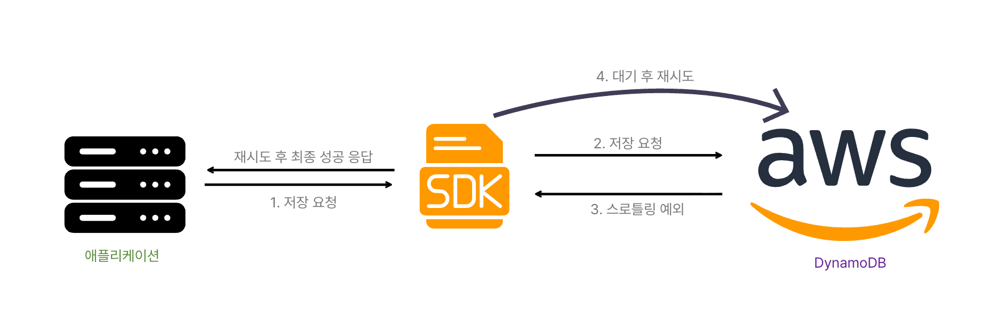

## 1. 들어가며

개인 프로젝트를 진행하며 DynamoDB에 저장하는 기능에서 약 300행을 처리하는 데 19초 가까이 걸리는 문제가 있었습니다.

처음에는 데이터를 순차적으로 저장하는 로직이 원인이라고 생각했습니다. 하지만 처리 시간을 분석하고 CloudWatch 지표를 확인하면서 예상과 다른 원인을 발견했습니다. 또한 원인을 추적하는 과정에서 DynamoDB의 쓰기 용량과 AWS SDK의 재시도 동작에 대해서도 새롭게 알게 되었습니다.

이 글에서는 저장 지연의 원인을 찾아가는 과정과 그 과정에서 알게 된 내용들을 정리하려고 합니다.

## 2. 문제 발견: 약 300행 저장에 18~19초가 걸렸다.
파일에서 읽은 데이터를 DynamoDB에 저장하는 과정에서 예상보다 긴 지연이 발생했습니다. 처리 시간을 확인해 보니 대부분의 시간이 저장 서비스 구간에서 발생했습니다.

| 측정 항목 | 첫 번째 시도 | 두 번째 시도 |
|---|---:|---:|
| 저장한 행 수 | 310행 | 300행 |
| 저장 서비스 소요 시간 | 18.216초 | 19.044초 |
| 성공한 배치 요청 수 | 13회 | 12회 |
| 성공한 배치의 평균 DynamoDB 처리 시간 | 8.63ms | 8.69ms |

이 표에서 중요한 것은 `저장 서비스 소요 시간` 과 `성공한 배치의 평균 처리 시간` 두 가지입니다.

- **성공한 Batch의 평균 처리 시간**
Batch는 평균 8.63ms 로 작업을 처리하였습니다.
- **저장 서비스 소요 시간**
Batch 하나의 기대 처리 시간이 8.63ms 라고 한다면 전체 저장 시간은 약 (8.63 * 13)ms 정도여야 합니다. 하지만 현재는 18~19초입니다.

### 첫 가설: 동기적인 처리 방식이 문제

처음에는 Batch 요청을 순차적으로 실행하는 방식이 지연의 원인이라고 생각했습니다. 각 요청의 응답을 기다린 뒤 다음 요청을 보내기 때문에 Batch를 병렬로 처리하면 전체 요청 응답 시간(Response Time)이 개선될 것이라고 생각했습니다.

하지만 성공한 요청의 처리 시간을 살펴보니 성공한 요청은 13회였고, 평균 DynamoDB 처리 시간은 8.63ms 였습니다. 이를 단순히 곱하면 약 112ms로, 현재 서비스 소요 시간과는 큰 차이가 났습니다.

## 3. 문제 발견: 쓰기 용량과 CloudWatch 지표로 확인한 병목

문제는 DynamoDB의 쓰기 용량이었습니다. 프로비저닝 모드였고, 쓰기 용량은 1 WCU로 설정되어 있었습니다.

### 쓰기 단위: WCU
DynamoDB의 쓰기 단위인 WCU를 이해할 필요가 있습니다. 

1 WCU는 1KB 이하의 데이터를 초당 한 행 저장할 수 있는 수준입니다. 반면에 문제의 기능은 수백 행을 짧은 시간 안에 저장해야 하는 작업이었습니다. 실제로 300행을 저장할 때 쓰기 용량 단위 300개가 소비됐습니다. 

#### 그럼 300초 걸려야 하는 것 아닌가?

DynamoDB에는 버스트 용량이 있습니다. 평소에 사용하지 않은 용량의 일부를 확보해 두었다가, 요청이 몰리면 설정한 처리량을 초과해서 사용할 수 있습니다. 그래서 1 WCU 였어도 수백 행을 300초보다 훨씬 빠르게 저장할 수 있었습니다.

하지만 CloudWatch 에서 확인한 결과 Throttling이 발생하였습니다. 버스트 용량이 있어도 모든 요청을 받아낼 만큼의 용량이 없었습니다.

## 4. 애플리케이션 로그에 에러가 없었다.

#### 애플리케이션의 경고 로그 없음

CloudWatch 에서는 Throttling이 확인됐지만 애플리케이션에는 재시도 경고 로그도 없었습니다. 서비스 로직에는 미처리 항목을 다시 보내는 로직과 경고 로깅을 하고 있었기 때문에 이 점이 의아했습니다.

코드를 살펴보니 해당 경고 로그는 BatchWriteItem 의 정상 응답에 UnprocessedItems 가 포함됐을 때 출력되는 구조였습니다. 일부 항목이 처리되지 않았다는 응답을 받은 뒤에 애플리케이션이 해당 항목을 다시 보내는 경우를 기록하고 있었습니다.

#### AWS SDK 의 재시도

재시도는 서비스 로직으로만 발생하는 것이 아니었습니다. AWS SDK도 Throttling 예외를 받으면 설정된 재시도 정책에 따라 잠시 기다렸다가 요청을 보냈습니다. 이 과정은 SDK 호출이 애플리케이션에 결과를 반환하기 전에 일어납니다. 

SDK 내부에서 재시도한 요청이 최종적으로 성공하고, 반환된 응답에 미처리 항목도 없다면 애플리케이션의 경고 로그는 출력되지 않습니다. 경고 로그가 없다는 사실만으로 재시도가 없었다고 판단할 수는 없었던 것입니다.

## 5. 그래서 문제는 어떻게 해결했나?

쓰기 용량 부족이 주요 병목이라고 판단하였고, 테이블의 용량 모드를 프로비저닝에서 온디맨드로 변경했습니다. 처음에 생각했던 배치 요청을 병렬로 처리하는 방식은 지금은 오버엔지니어링이라고 생각하고 기존의 순차 저장 방식을 유지했습니다.

| 비교 항목 | 전환 전 | 전환 후 |
|---|---:|---:|
| 저장한 행 수 | 310행 | 310행 |
| 용량 모드 | 프로비저닝, 1 WCU | 온디맨드 |
| 저장 서비스 소요 시간 | 18.216초 | 1.795초 |
| 성공한 배치 요청 수 | 13회 | 13회 |
| 스로틀링 | 관측됨 | 관측되지 않음 |

저장 서비스 소요 시간은 10배 가까이 빨라졌습니다. 비용도 개인 프로젝트 특성상 온디맨드 방식이 합당하다고 판단하였습니다.

## 마치며

이번 문제를 분석하며 애플리케이션에서 한 번 호출한 쓰기 요청이 실제로는 여러 차례의 요청으로 이어질 수 있다는 것을 알게 되었습니다.

기존에는 정상 응답에 포함된 UnprocessedItems 를 확인하고 다시 보내는 코드에 주목했습니다. 하지만 Throttling에 대한 재시도는 AWS SDK 내부에서도 발생할 수 있었고 경고 로그가 없었던 것도 설명할 수 있었습니다.