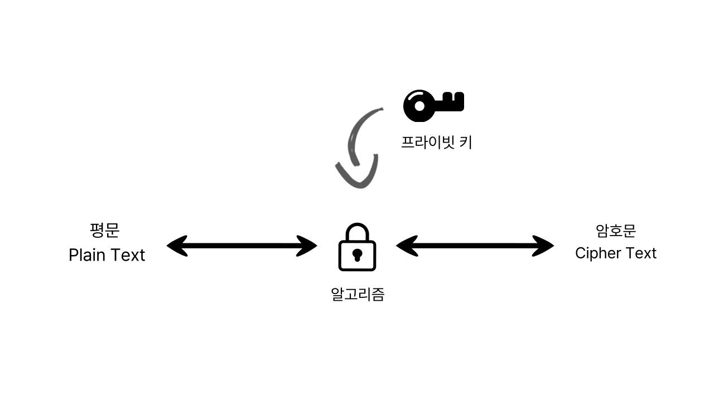
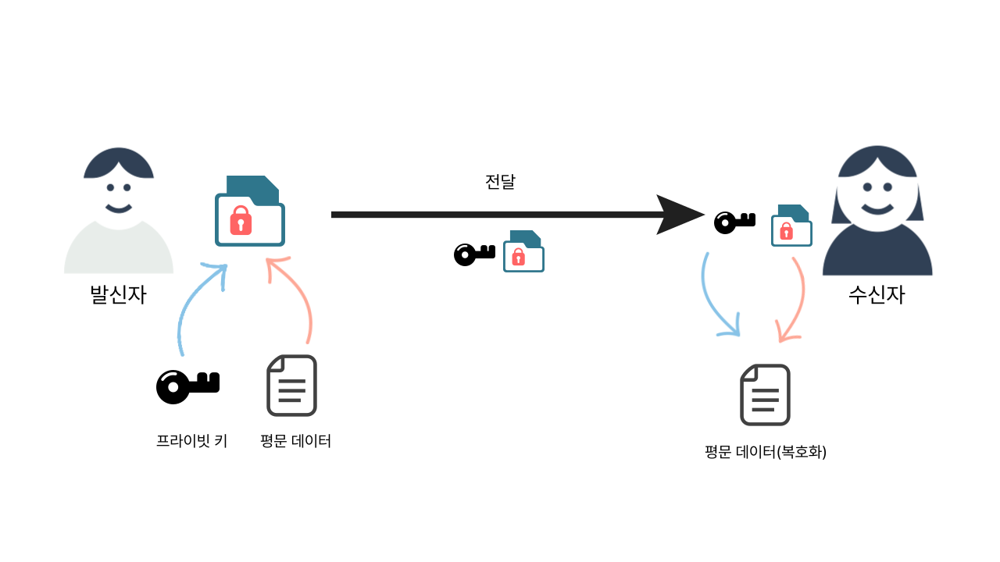
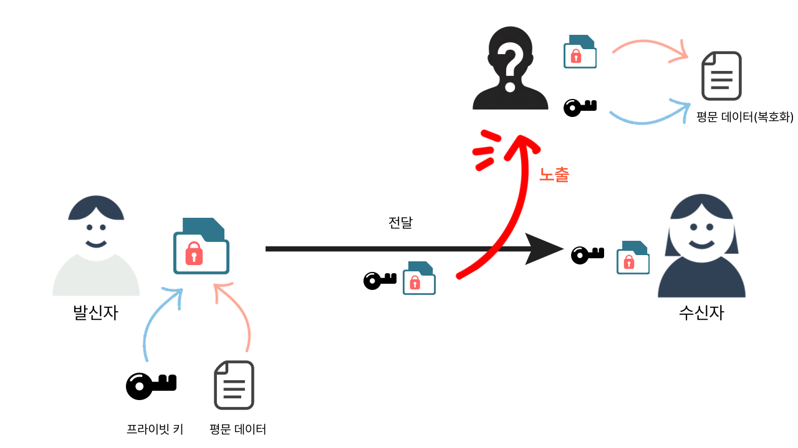
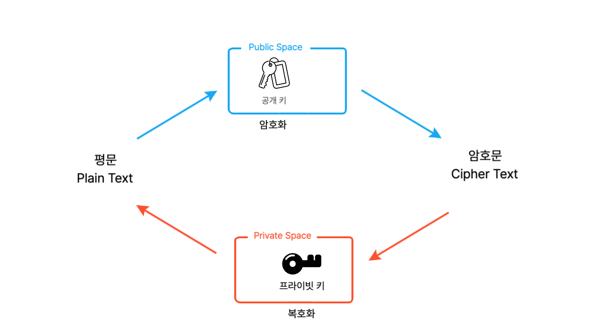
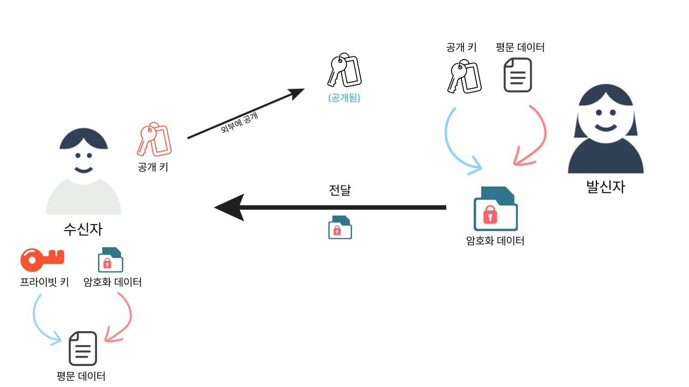

### 대칭키(Symmetric Key)

**원리:** 하나의 같은 키를 가지고 암호화와 복호화를 한다.
**비유:** 한 개의 집 열쇠로 문을 잠그고, 같은 열쇠로 문을 연다.

**장점:** 빠르고 간단하다.
**단점:** 키 전달 과정에서 노출 될 가능성이 크다.

 

발신자는 **키** 를 이용해 **평문 데이터** 를 암호화 하고, **Private key** 와 **암호화 문서** 를 전달합니다.
수신자는 **키** 를 가지고 **암호화 문서** 를 복호화 하여 **평문 데이터** 를 확인 할 수 있습니다.

 

하지만 제 3자에게 노출될 수 있습니다. 그 사람은 **키** 와 **암호화 문서** 가 있으니 데이터를 확인 할 수 있게 되는 것이죠.

*대칭키(Symmetric Key)* 방식의 심각한 에러입니다.

 

---

### 비대칭키(Asymmetric Key)

**원리:** 두 개의 다른 키를 사용한다. 
공개 키로 암호화 -> 프라이빗 키로 복호화 가능

**비유:** 
공개 키 = 누구나 볼 수 있는 우체통
프라이빗 키 = 나만 가진 우체통 열쇠
누구나 내 우체통에 편지를 넣을 수 있지만, 열어서 읽을 수 있는 건 나 뿐이다.

**장점:** 키 교환 문제가 해결된다.
**단점:** 연산 속도가 느리다.

 

수신자는 *공개 키* 를 공유하고 데이터 발신자는 **공개 키** 를 이용해 **평문 데이터** 를 암호화 한다. 그리고 수신자에게 **암호화 데이터** 를 보낸다.
수신자는 **프라이빗 키** 를 이용해 **암호화 데이터** 를 복호화 한다.

제 3자는 **암호화 데이터** 와 **공개 키** 를 알 수 있지만 **프라이빗 키** 를 모르기 때문에 복호화 할 수 없다.

---

### HTTPS 의 TLS Handshake

HTTPS 는 브라우저와 서버 사이에 TLS Handshake 를 해서, 처음엔 **비대칭키** 로 안전하게 **대칭키(세션 키)**를 교환하고, 이후에는 그 세션 키를 이용해 대칭키 암호화로 데이터를 주고받는다.

