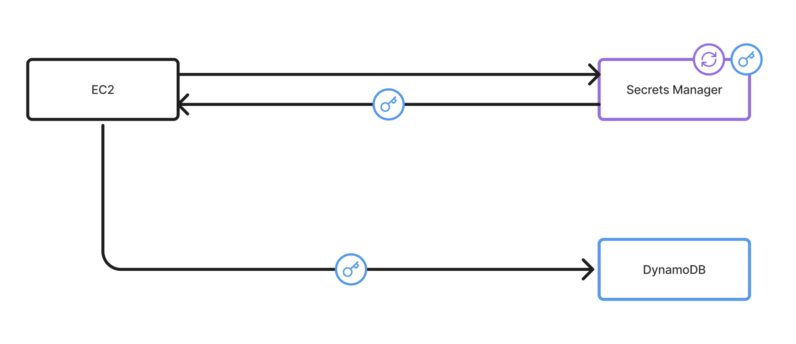
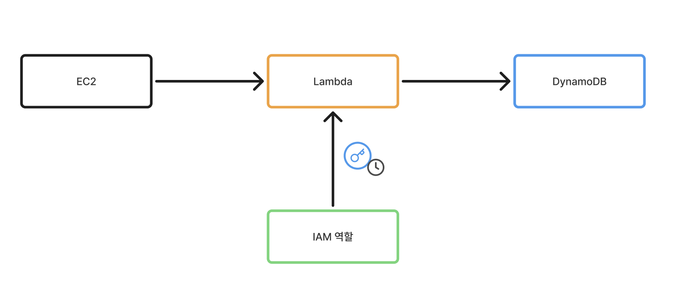
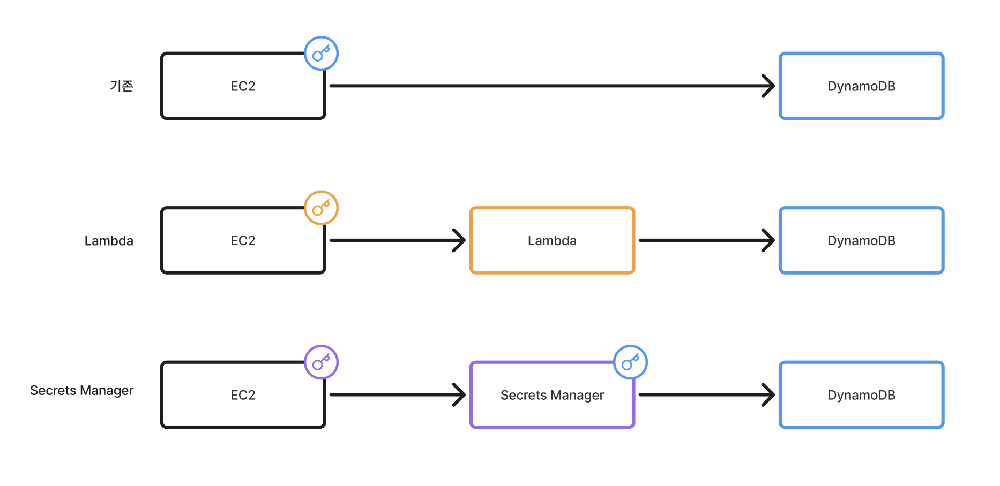
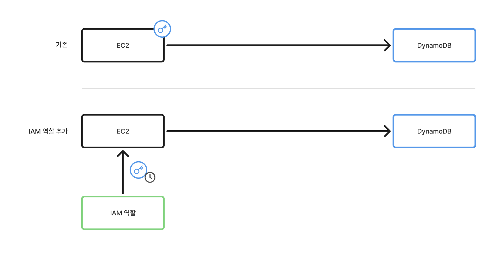

## 들어가며

개발을 하고 운영을 시작하게 되면 시크릿 값에 대한 걱정이 생깁니다. 어디에 어떻게 보관하고 관리할지 고민을 하게 되죠. 최근들어 잦은 해킹에 더욱 고민이 깊어집니다.

**"여러분은 시크릿 값을 어떻게 관리하고 계신가요?"**

저의 사이드 프로젝트에서는 단순하게 .env 에 넣고 관리를 하였습니다. 그런데 이 방식에는 신경쓰이는 점이 있었습니다. 만약 EC2가 털린다면 .env 안에 있는 모든 시크릿 값이 함께 유출된다는 것이었습니다.

그래서 서버에서 시크릿 값을 직접 관리하지 말아야겠다고 생각했습니다. 서버에 존재하는 시크릿 값을 숨기기 위한 첫 여정의 시작은 DynamoDB 접근을 위한 시크릿 값 숨기기였습니다.

그리고 시크릿 값을 숨기기 위한 방법으로 AWS Secrets Manager 와 Lambda, 그리고 IAM 역할을 비교하였고 IAM 역할을 선택한 이유를 공유하려고 합니다.

## 1. 첫 번째 선택지 - Secrets Manager

AWS Secrets Manager는 시크릿 값을 보관하고 주기적으로 순환(rotation)시켜줄 수 있는 서비스입니다.

**그럼 Secrets Manager 를 사용하면 되는 거 아니에요?**

하지만 이번에 숨기려는 것은 DynamoDB 호출을 위한 AWS 액세스 키였습니다. 인스턴스에 역할 하나만 추가하면 되는 일을 Secrets Manager 에 맡기면 관리 포인트만 하나 더 늘어난다고 판단하였습니다. 그래서 Secrets Manager 는 제외하였습니다.

## 2. 두 번째 선택지 - Lambda

다음으로 떠올린 방법은 EC2 와 DynamoDB 사이에 Lambda 를 두는 것이었습니다. SNS 메세지를 받은 Lambda 가 다른 AWS 서비스를 호출하는 구조를 보고 떠올린 방법이었습니다.

Lambda 는 함수가 실행될 때 역할의 임시 자격 증명을 받기 때문에 EC2 에서 DynamoDB 시크릿 값을 관리할 필요가 없었습니다. 이 방법 역시 검토만 하였습니다.

## 3. 두 방식의 한계

두 방법을 검토하면서 EC2에서 DynamoDB까지 데이터가 어떻게 흘러가는지 머릿속으로 그려보았습니다. 그러다 두 방법 모두 같은 문제를 갖고 있다는 것을 알았습니다.

### 3-1. Lambda 의 한계

Lambda를 중간에 두면 DynamoDB의 시크릿 값은 숨길 수 있습니다. 하지만 서버에는 Lambda 함수를 호출하기 위한 시크릿 값이 새로 생깁니다. 만약 Lambda 역할을 추가하는 것으로 방금 문제를 해결한다면 굳이 Lambda 역할 말고 DynamoDB 역할을 붙이면 되니 관리 포인트만 늘어나는 것이었습니다.

### 3-2. Secrets Manager 의 한계

Secrets Manager 에서 시크릿 값을 꺼내려면 이 또한 자격 증명이 필요합니다. 물론 역할을 추가하면 되지만, DynamoDB 역시 역할을 추가하면 해결되는 것이므로 데이터 흐름에서 노드만 하나 더 생기는 것이었습니다. 

## 4. 세 번째 선택지 - EC2 에 IAM 역할 추가

마지막으로 검토한 방법은 EC2에 IAM 역할을 붙이는 것입니다. 이 방식에서도 AWS를 호출하려면 키가 필요하다는 점은 같습니다. 달라지는 것은 그 키를 누가 들고 있느냐입니다.

역할 방식에서는 서버 파일에 키가 없습니다. 대신 SDK가 필요할 때마다 AWS에게 임시 키를 받아서 사용합니다.

키를 없애는 것이 아니라 제가 키를 저장하고 관리하지 않아도 되는 것입니다. 키는 AWS가 발급하고 만료시키고, 다시 발급합니다.

## 5.  최종 선택

최종적으로 EC2에 IAM 역할을 붙이는 방식을 선택했습니다.

Lambda를 중간에 두면 DynamoDB의 시크릿 값은 숨길 수 있지만 Lambda 함수를 호출하기 위한 시크릿 값이 새로 생깁니다. Secrets Manager도 관리 포인트만 하나 더 늘어납니다.

이번에 숨기려던 것은 외부 시스템을 위한 시크릿 값이 아닌 AWS 서비스의 시크릿 값이었고, 인스턴스 역할만 추가하면 되는 일이었습니다. 

역할 방식은 서버에 시크릿 값을 남기지 않으면서, 새로 관리할 것도 늘리지 않는 유일한 선택지였습니다.

## 마치며

시크릿 값을 숨기려고 새로운 구성 요소를 두면 그 구성 요소를 호출하기 위한 시크릿 값이 다시 생긴다는 것을 데이터 흐름을 따라가며 알게 되었습니다. 그래서 다른 방법과 비교하며 최선의 선택을 하였습니다.

다만 역할 방식도 EC2가 털리는 상황까지 막아 주지는 못합니다. 해커가 EC2 안에 들어오면 그 안에서는 역할의 권한으로 DynamoDB에 접근할 수 있습니다. 대신 서버에 영구 키가 없으니 키를 들고 나가 계속 쓸 수는 없습니다. 빼낸 임시 키도 만료될 때까지만 쓸 수 있습니다.

.env에 남은 다른 외부 시스템의 시크릿 값은 Secrets Manager에서 관리할 예정입니다. 이때는 EC2에 붙인 역할에 Secrets Manager 조회 권한을 추가하면 서버에서 시크릿 값을 관리할 필요 없이 외부 시스템의 시크릿 값을 꺼내 쓸 수 있습니다.

